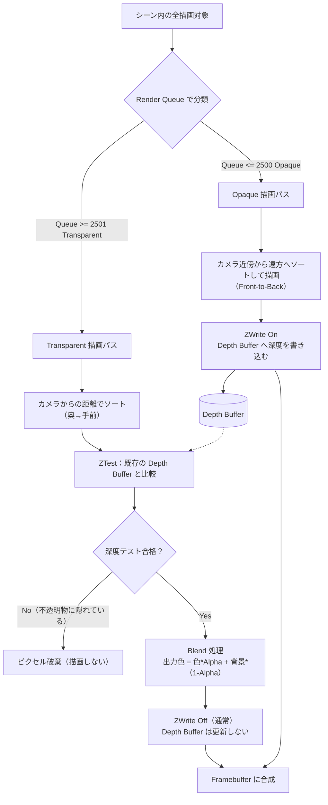
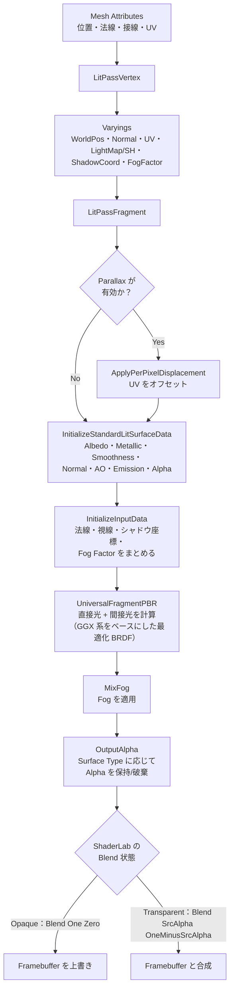

# Chapter 06：PBR の Unity 実装と URP/Lit の構造

この章は `URPシェーダープログラミングindex.md` の Chapter 06 に対応します。Chapter 05 の `SurfaceInputs05.shader` を出発点に、Phong ライティングを正規化 Lambert と Cook-Torrance モデルへ置き換えます。あわせて、URP/Lit の描画状態、Transparent の処理、ShaderLab の `#pragma` と共通 HLSL の構成を調べます。

> この章のカスタムシェーダーは、PBR の主要な計算を学ぶための教材です。ライトマップ、Reflection Probe、全シャドウ機能などを含む URP/Lit と同等の機能を実装するものではありません。

## 1. 学習目標

- `SurfaceInputs05.shader` のマテリアル入力とライティングを分けて理解する
- Lambert 拡散反射を正規化する理由を説明できる
- Cook-Torrance の D・G・F の役割を説明できる
- `Surface Type` がマテリアル設定、描画キュー、ブレンド状態に反映される流れを追う
- URP/Lit の Forward パスと共通 HLSL の役割を説明できる
- `shader_feature` と `multi_compile` の用途を区別できる

### 1.1 実習手順と観察ポイント

1. `Chapter06.unity` を開き、比較対象オブジェクトのマテリアルを確認する
2. `Assets/ShaderProgramming/Chapter06/Transparent06.shader` からマテリアル `Transparent06` を作成する
3. Base Color の Alpha を `1.0` から `0.3` などへ下げ、透明化の変化を確認する
4. Metallic / Smoothness / Base Map Alpha を個別に調整し、見た目変化の原因を分離して観察する

`Chapter06.unity` の初期配置は、比較観察しやすいように次の構成になっています。

- Sphere: `SurfaceInputs05`（`SphereMaterial`）
- Cube と Plane: URP/Lit
- 2つの Cube: `Transparent06`

最初に Sphere（Chapter 05）と Transparent06 の反射差を見比べ、その後に Alpha を下げて透明描画の挙動を確認すると、PBR 化と透明化の違いを切り分けやすくなります。

## 2. Chapter 05 のシェーダーと URP/Lit の違い

`Assets/ShaderProgramming/Chapter05/SurfaceInputs05.shader` は、アルベド、法線、Metallic、Smoothness、AO、Emission などの値を `SurfaceInputs` に集めます。その後、`ShadePhong` がライトごとの色を計算します。

| 項目 | `SurfaceInputs05.shader` | URP/Lit |
| :--- | :--- | :--- |
| マテリアル入力 | `InitializeSurfaceInputs` で取得 | `InitializeStandardLitSurfaceData` で取得 |
| 反射モデル | Phong の拡散反射・鏡面反射 | Metallic/Specular ワークフローに対応した BRDF |
| ライト計算 | 教材内の `ShadePhong` | `UniversalFragmentPBR` と `LightingPhysicallyBased` など（GGX 系をベースにした最適化近似） |
| 描画機能 | 主に Universal Forward | Forward、ShadowCaster、DepthOnly、GBuffer など複数のパス |
| マテリアル設定 | シェーダー内の固定値が中心 | Inspector がキーワード、描画キュー、Blend、ZWrite などを更新 |
| 汎用性 | 学習対象を絞った実装 | ライト、GI、シャドウ、デカール、インスタンシングなどと連携 |

Chapter 06 では `SurfaceInputs` とテクスチャ読み込みをなるべく維持し、主に `ShadePhong` を置き換えます。これにより、見た目の変化をライティングモデルの差として確認できます。

## 3. PBR の基礎

### 3.1 Lambert 拡散反射の正規化

Chapter 05 の Lambert 相当の項は、概ね次の形です。

```hlsl
half3 diffuse = albedo * radiance * NdotL;
```

ここで `NdotL = saturate(dot(N, L))` です。BRDF として扱う場合、Lambert 拡散反射は `albedo / π` で正規化します。

```hlsl
float3 diffuseBRDF = (1.0 - F) * (1.0 - metallic) * albedo / 3.14159265;
```

`1 / π` は半球全体へ反射するエネルギーが過大にならないようにする係数です。ここでは金属の拡散反射をなくす近似として `(1 - metallic)` を掛け、さらに `(1 - F)` で鏡面反射へ回った分のエネルギーを拡散側から差し引きます（簡易的なエネルギー保存）。

> 注意: この章の実装は拡散項に `1/π` を入れるため、同じライト設定でも URP/Lit や Chapter 05 より見た目が暗くなります。URP の標準ライトは実質的に `π` を掛けた慣習値で扱われ、URP/Lit の拡散項には `1/π` が直接入りません。たとえば `_Ambient = 0.05` は `0.05 / π ≒ 0.016` まで下がります。

### 3.2 Cook-Torrance の鏡面反射

Cook-Torrance の鏡面反射は、概念的には次の構成です。

```text
specular BRDF = D * G * F / (4 * NoV * NoL)
```

- **D — Normal Distribution Function**: 微小面の法線がどの程度分布しているか。URP は GGX 系の分布を使います。
- **G — Geometry / Visibility**: 微小面どうしが遮蔽し合う影響。
- **F — Fresnel**: 視線と表面の角度による反射率の変化。教材では Schlick 近似を使います。
- **NoV / NoL**: 法線と視線、法線とライト方向の内積です。

Metallic ワークフローでは、正面から見た鏡面反射率 `F0` を絶縁体の約 0.04 とアルベドの間で補間します。

```hlsl
float3 F0 = lerp(float3(0.04, 0.04, 0.04), albedo, metallic);
```

この章で `roughness` と呼んでいる値は、URP でいう `perceptualRoughness` に相当します。式中の `alpha = roughness * roughness` が、GGX 計算に使う実効的な roughness（分布パラメータ）です。URP/Lit も perceptual roughness と roughness を区別し、計算上の下限や数値安定性への配慮を加えています。

## 4. `Surface Type` と Transparent の仕組み

### 4.1 Inspector の選択だけでは透明にならない

URP/Lit の `_Surface` は、Opaque / Transparent を表すマテリアルプロパティです。Inspector の選択を受けて `BaseShaderGUI` がマテリアルの描画設定を更新します。選択値が直接 GPU の描画状態を切り替えるのではなく、次のような設定に反映されます。

- `_SURFACE_TYPE_TRANSPARENT` キーワード
- RGB / Alpha の SrcBlend と DstBlend
- `_ZWrite`
- `RenderType` タグ
- Render Queue
- Alpha Clip などの関連キーワード

Opaque では通常、`Blend One Zero`、`ZWrite On`、Geometry キューを使います。Transparent ではブレンドモードに応じた Blend 値を設定し、通常は `ZWrite Off`、Transparent キューにします。

URP/Lit の `ForwardLit` パスでは、これらの値を ShaderLab の描画状態として参照します。

```shaderlab
Blend[_SrcBlend][_DstBlend], [_SrcBlendAlpha][_DstBlendAlpha]
ZWrite[_ZWrite]
Cull[_Cull]
AlphaToMask[_AlphaToMask]
```

`_SrcBlend` などは `Lit.shader` の Properties では HideInInspector のプロパティです。Inspector の Surface Options で選んだ設定を、Material Inspector 側の処理が更新します。

### 4.2 Transparent の描画順と深度

URP は Render Queue を使って描画対象を分類します。通常の流れを概念化すると、Opaque を先に描画し、その後 Transparent を描画します。Transparent の描画は一般に奥から手前へソートされます。

1. 不透明物を描画し、深度バッファへ深度を書き込む
2. 透明物を Transparent の描画対象として処理する
3. 透明物は背景色とブレンドする
4. 通常は透明物自身の深度を書き込まない

#### Render Queue と 2500 の境界

Render Queue は単なる任意の整数ではなく、Unity があらかじめ定義した名前付きの基準値を持っています。

| Queue 名 | 値 | 用途 |
| --- | --- | --- |
| `Background` | 1000 | スカイボックスなど最初に描く背景 |
| `Geometry` | 2000 | 通常の不透明オブジェクト（デフォルト） |
| `AlphaTest` | 2450 | Alpha Clip（カットアウト）を使う不透明寄りのオブジェクト |
| `Transparent` | 3000 | 半透明オブジェクト |
| `Overlay` | 4000 | UI など最後に描く要素 |

この表からわかるように、**2500** という境界は `AlphaTest`（2450）と `Transparent`（3000）のちょうど中間に位置する値です。URP の `FilteringSettings` は `RenderQueueRange` を使って Opaque パスと Transparent パスの対象を分けますが、その定義は次のようになっています。

- Opaque 用の `RenderQueueRange`：`minimum = 0`、`maximum = 2500`
- Transparent 用の `RenderQueueRange`：`minimum = 2501`、`maximum = 5000`

つまり「2500」はコード上で定数として決められた閾値であり、`AlphaTest`（2450）までは Opaque 側、`Transparent`（3000）以降は Transparent 側に収まるように設計されています。

**どのタイミングで値が設定されるか**

マテリアルの `renderQueue` は、以下のタイミングで決定・反映されます。

1. シェーダーの `Tags { "Queue" = "Geometry" }` のように、SubShader タグでデフォルト値が宣言される
2. マテリアルを作成した時点で、そのデフォルト値が `Material.renderQueue` にコピーされる（Inspector 上では「Surface Type」が Opaque か Transparent かで自動的に `Geometry` か `Transparent` が選ばれる）
3. スクリプトから `material.renderQueue = 2500;` のように実行時に明示的へ上書きすることも可能
4. `CommandBuffer.DrawRenderer` など描画時にマテリアルが参照され、そのときの `renderQueue` 値を使って `DrawObjectsPass` がフィルタリングを行う

つまり、Render Queue はシェーダーコンパイル時ではなく、**マテリアルがその値を保持しており、描画パスが実行される毎フレーム、フィルタリング時に参照される**という仕組みです。そのため、スクリプトから動的に `renderQueue` を変更すれば、実行時に Opaque/Transparent の扱いを切り替えることもできます。

**オブジェクトの Queue が 2500 を超える場合どうなるか**

あるオブジェクトのマテリアルが `renderQueue = 2501` 以上（例えば `Transparent` = 3000）を持つ場合、そのオブジェクトは次のように扱われます。

- Opaque 用 `RenderQueueRange`（0〜2500）には含まれないため、Opaque 描画パスの対象から除外される
- Transparent 用 `RenderQueueRange`（2501〜5000）に含まれるため、Transparent 描画パスの対象になる
- Transparent パスでは奥から手前へのソートが行われ、ZWrite Off・Blend 処理が適用される（4.2 冒頭の図を参照）
- 深度バッファへの書き込みは行われないため、後から描画される他の Transparent オブジェクトはこのオブジェクトの深度でクリップされない（ソートアーティファクトの原因になりうる）

逆に、本来 Opaque のつもりで作ったマテリアルの `renderQueue` を誤って 2501 以上に設定してしまうと、意図せず ZWrite Off のまま Transparent パスで描画されてしまい、深度が書き込まれない・不透明なのに背景と変にブレンドされるといった不具合につながることがあるため注意が必要です。

深度テストと深度書き込みは別の設定です。Transparent は通常 `ZWrite Off` ですが、Opaque が書いた深度との比較は引き続き行います。そのため、壁の後ろにある透明物は壁の深度によって隠れます。一方、透明物どうしの重なりはソート順に影響され、交差する透明面などは正確に解決できないことがあります。

URP の `DrawObjectsPass` は Render Queue 範囲と ShaderTag を使って対象を選びます。`UniversalForward` は Forward 描画対象を識別する LightMode の一つです。マテリアルの Transparent 設定は、シェーダーのブレンド状態を変えるだけでなく、描画キューによる分類にも関係します。

以下に、Opaque と Transparent の描画順序、深度バッファへの関与方法を図解します。



この図からもわかる通り、Transparent は Opaque が書き込んだ Depth Buffer を参照（ZTest）しつつも、自身の深度は書き込まず（ZWrite Off）、カメラからの距離順でソートされて順次ブレンドされます。そのため、透明物同士が交差すると正しくソートできず、視覚的な破綻（ソートアーティファクト）が発生することがあります。

### 4.3 Alpha Blend と Premultiply

通常の Alpha Blend は次の式です。

```text
出力色 = 表面色 * 表面Alpha + 背景色 * (1 - 表面Alpha)
```

Premultiply モードでは、シェーダー側で色の Alpha 処理を行い、Blend 側では `One` と `OneMinusSrcAlpha` を使う構成になります。URP/Lit は、拡散反射と鏡面反射を異なる扱いにする設定も持ちます。したがって、透明設定では Alpha 値だけでなく、マテリアルの Blend Mode と BRDF が出力する色との整合が必要です。

Alpha Clip は透明ブレンドとは異なります。しきい値未満のピクセルを `clip` で破棄し、描画するピクセルとしないピクセルを分ける方式です。

## 5. Forward パスの処理の流れ

URP/Lit の Forward パスは、概略として次の処理を行います。

1. 頂点シェーダーで位置、法線、接線、UV、ライトマップなどを準備する
2. フラグメントシェーダーで必要なら Parallax を適用する
3. `InitializeStandardLitSurfaceData` でマテリアル入力を作る
4. `InitializeInputData` で法線、視線、シャドウ座標などを作る
5. `UniversalFragmentPBR` で直接光と間接光を計算する
6. Fog を適用し、Transparent では出力 Alpha を保つ

`LitForwardPass.hlsl` のフラグメント処理では、マテリアル入力を初期化した後に `UniversalFragmentPBR` を呼び出します。ShaderLab 側の `Blend` 状態が、その戻り値とフレームバッファの色を合成します。

以下に、Forward パスにおける頂点シェーダーからフラグメントシェーダーまでの処理の流れを図解します。



この図が示すように、Forward パスは「頂点データの準備 → SurfaceData/InputData の構築 → PBR 計算 → Fog/Alpha 出力 → ShaderLab の Blend 合成」という一連の流れで処理されます。Transparent かどうかはこの流れ自体を変えるのではなく、最終段の Blend 状態と Alpha 出力の扱いに反映される点がポイントです。

つまり、Transparent は「透明色を返すだけ」の仕組みではありません。シェーダーの Alpha 出力、Blend 状態、Render Queue、描画順、深度状態が組み合わさって実現されています。

## 6. `SurfaceInputs05.shader` から `Transparent06.shader` を作る

完成成果物は `Assets/ShaderProgramming/Chapter06/Transparent06.shader` です。次の手順は、Chapter 05 のどのファイルのどの関数・Pass を編集するかを示します。コードを個別に書き換えて検証する場合も、最後に完成版と同じ状態になるようにしてください。

見た目の変化要因を切り分けるため、まず **Opaque のまま PBR 化** を確認し、その後に Transparent 化する順序を推奨します。具体的には、段階 1 → 3 → 4 → 5 → 6 → 7 → 8 を先に適用して Opaque PBR 版を確認し、最後に段階 2 の Transparent 設定を適用します。

### 段階 1：Chapter 05 のシェーダーを複製する

1. `Assets/ShaderProgramming/Chapter05/SurfaceInputs05.shader` を複製します。
2. 複製先を `Assets/ShaderProgramming/Chapter06/Transparent06.shader` にします。
3. ファイル先頭の Shader 名を変更します。

```shaderlab
Shader "ShaderProgramming/Chapter6/Transparent06"
```

この時点では、`InitializeSurfaceInputs`、`ShadePhong`、`frag` の計算はまだ変更しません。Chapter 05 の入力処理とライティング構造を引き継いでいることを確認します。

### 段階 2：ShaderLab の Transparent 描画状態を追加する

`SubShader` の `Tags` を変更します。

```shaderlab
Tags { "Queue"="Transparent" "RenderType"="Transparent" "RenderPipeline"="UniversalPipeline" }
```

`Pass` の `Tags { "LightMode"="UniversalForward" }` の直後に、次の描画状態を追加します。

```shaderlab
Blend SrcAlpha OneMinusSrcAlpha
ZWrite Off
Cull Back
```

ここでは教育用に Alpha Blend を固定しています。URP/Lit のように Inspector から Surface Type や Blend Mode を切り替える仕組みはまだ作りません。Queue が Transparent になることで描画対象が透明キューに分類され、Blend が現在のフレームバッファとの合成を指定し、ZWrite Off がこのパスから深度を書き込まないことを指定します。

### 段階 3：Alpha Clip を取り除き、透過 Alpha を使う

#### 変更箇所 A：`Properties`

`_Cutoff` プロパティを削除します。これは Alpha Clip のしきい値用で、通常の Alpha Blend では必要ありません。透明度は既存の `_BaseColor.a` と Base Map の Alpha で指定します。

#### 変更箇所 B：`CBUFFER_START(UnityPerMaterial)`

`_Cutoff` の宣言を削除します。

#### 変更箇所 C：`InitializeSurfaceInputs`

`surface.alpha` を設定した直後にある次の行を削除します。

```hlsl
clip(surface.alpha - _Cutoff);
```

`surface.alpha = albedoAlpha.a;` は残します。`frag` の最後からこの Alpha を出力し、Pass の Blend 状態で背景色と合成します。Alpha Clip と Transparent Blend は別機能なので、`clip` を残すと Alpha が低い箇所はブレンドされずに破棄されます。

### 段階 4：`SurfaceInputs` から Phong 専用 Clear Coat 入力を外す

今回の完成版は基本的な Metallic Cook-Torrance に範囲を絞り、Chapter 05 で実装していた追加 Phong ハイライトを含めません。以下の箇所から Clear Coat を削除します。

1. `Properties` の `_ClearCoatMap`、`_ClearCoatMask`、`_ClearCoatSmoothness`
2. テクスチャ宣言の `_ClearCoatMap`
3. `UnityPerMaterial` の `_ClearCoatMask`、`_ClearCoatSmoothness`
4. `SurfaceInputs` の `clearCoatMask`、`clearCoatSmoothness`
5. `InitializeSurfaceInputs` 内の Clear Coat Map のサンプリング部分
6. `ShadePhong` 内の `coatShininess` と `clearCoat` の計算（次の段階で関数全体を置換）

Clear Coat 値が構造体に残っていても Cook-Torrance に自動で反映されることはありません。URP/Lit のような二層 BRDF は別の拡張として扱います。

### 段階 5：`ShadePhong` 関数全体を Cook-Torrance に置き換える

`SurfaceInputs05.shader` の `half3 ShadePhong(...)` 関数定義全体（開始行から対応する `}` まで）を削除し、同じ場所に以下を追加します。手順 3・4 の適用後は行番号が変わるため、関数名を基準に特定してください。GGX NDF、Schlick-GGX Geometry 近似、Schlick Fresnel を組み合わせた教材用の実装です。

```hlsl
half3 ShadeCookTorrance(Light light, SurfaceInputs surface, half3 N, half3 V)
{
    float3 normal = SafeNormalize((float3)N);
    float3 viewDir = SafeNormalize((float3)V);
    float3 lightDir = SafeNormalize((float3)light.direction);
    float3 halfDir = SafeNormalize(viewDir + lightDir);

    float NoL = saturate(dot(normal, lightDir));
    float NoV = max(saturate(dot(normal, viewDir)), 1e-4);
    float NoH = saturate(dot(normal, halfDir));
    float VoH = saturate(dot(viewDir, halfDir));

    float metallic = saturate((float)surface.metallic);
    float roughness = max(1.0 - (float)surface.smoothness, 0.045);
    float alpha = roughness * roughness;
    float alpha2 = alpha * alpha;

    float denominator = NoH * NoH * (alpha2 - 1.0) + 1.0;
    float D = alpha2 / max(3.14159265 * denominator * denominator, 1e-5);

    float k = (roughness + 1.0) * (roughness + 1.0) / 8.0;
    float Gv = NoV / max(NoV * (1.0 - k) + k, 1e-5);
    float Gl = NoL / max(NoL * (1.0 - k) + k, 1e-5);
    float G = Gv * Gl;

    float3 albedo = (float3)surface.albedo;
    float3 F0 = lerp(float3(0.04, 0.04, 0.04), albedo, metallic);
    float3 F = F0 + (1.0 - F0) * pow(1.0 - VoH, 5.0);

    float3 specularBRDF = D * G * F / max(4.0 * NoV * NoL, 1e-5);
    float3 diffuseBRDF = (1.0 - F) * (1.0 - metallic) * albedo / 3.14159265;

    float attenuation = (float)light.distanceAttenuation * (float)light.shadowAttenuation;
    float3 radiance = (float3)light.color * attenuation;
    return (half3)((diffuseBRDF + specularBRDF) * radiance * NoL);
}
```

Chapter 05 の `pow(saturate(dot(N, H)), shininess)` による Phong ハイライトと違い、この関数は D・G・F の項を組み合わせます。`max` の下限はゼロ除算を避けるためのものです。

### 段階 5.5：Opaque PBR の中間確認

段階 2（Transparent 化）をまだ適用していない場合、この時点で見た目差分を確認します。

- 変わる要素: BRDF（Phong → Cook-Torrance）、`1/π` 正規化、Fresnel
- 変わらない要素: Render Queue、Blend、ZWrite

この確認を入れると、「暗くなった理由が PBR 化か、透明化か」を分離して検証できます。

### 段階 6：`frag` の AO と Main Light の計算を更新する

`half4 frag(Varyings IN)` 内で法線をワールド空間へ変換した後、Chapter 05 では次のように環境光と Main Light を計算しています。

```hlsl
half3 color = _Ambient.rgb * surface.albedo * surface.occlusion;
color += ShadePhong(GetMainLight(), surface, N, V) * surface.occlusion;
```

この部分を、次に置き換えます。

```hlsl
half3 ambientDiffuse = _Ambient.rgb * surface.albedo
    * (1.0h - surface.metallic) * surface.occlusion / 3.14159265h;
half3 color = ambientDiffuse;
color += ShadeCookTorrance(GetMainLight(), surface, N, V);
```

ここでは AO を簡易環境光へ掛け、直接光には一律で掛けません。`_Ambient` は URP/Lit のライトマップや Reflection Probe の代替ではなく、学習用の定数環境光です。

### 段階 7：Additional Lights のループ内呼び出しを更新する

`frag` 内の `LIGHT_LOOP_BEGIN(count)` と `LIGHT_LOOP_END` は残します。ループ内部の次の行だけを変更します。

```hlsl
color += ShadeCookTorrance(GetAdditionalLight(lightIndex, IN.positionWS), surface, N, V);
```

つまり、Chapter 05 の `ShadePhong(...) * surface.occlusion` を `ShadeCookTorrance(...)` に置き換えます。Additional Lights の取得とループ構造は維持し、Main Light と同じ Cook-Torrance 関数を使います。

Forward+ では `LIGHT_LOOP_BEGIN` が `InputData` を参照するため、`frag` 内に次の宣言を残してください。

```hlsl
InputData inputData = (InputData)0;
inputData.positionWS = IN.positionWS;
inputData.normalWS = N;
inputData.viewDirectionWS = V;
GetNormalizedScreenSpaceUV(IN.positionHCS)
```

この章のシェーダーは Forward+ の全フィールドを使いませんが、ループマクロの展開上、最小限の `InputData` が必要です。

### 段階 8：`frag` の戻り値で Emission と Alpha を維持する

`frag` の末尾の次の行は残します。

```hlsl
return half4(color + surface.emission, surface.alpha);
```

`surface.alpha` は Base Map と `_BaseColor` から取得します。これが Pass の `Blend SrcAlpha OneMinusSrcAlpha` に渡されます。透明オブジェクトが交差する場合など、Transparent の描画順による制約は残ります。

補足として、本文の `light.shadowAttenuation` は現状の呼び出し（`GetMainLight()` と `GetAdditionalLight(lightIndex, IN.positionWS)`）では実質 1 のままで、Chapter 06 では影の減衰に効きません。シャドウ座標を使う呼び出しや ShadowCaster/DepthOnly パスは Chapter 07 以降で扱います。

また、この `Transparent06.shader` には ShadowCaster/DepthOnly パスを実装していないため、透明オブジェクトはこの章の時点で影を落としません。

### 段階 9：完成版の対応関係を確認する

各段階で次のメソッド・ブロックを確認します。

| `SurfaceInputs05.shader` の箇所 | Chapter 06 での変更 |
| :--- | :--- |
| Shader 宣言 | `Shader "ShaderProgramming/Chapter6/Transparent06"` に変更 |
| `SubShader` の Tags | Queue と RenderType を Transparent に変更 |
| UniversalForward Pass の状態 | Alpha Blend、ZWrite Off、Cull Back を追加 |
| Properties / CBUFFER | Alpha Clip と Phong Clear Coat 専用の宣言を削除 |
| `InitializeSurfaceInputs` | `clip` と Clear Coat サンプリングを削除し、Alpha は維持 |
| `ShadePhong` | 関数全体を `ShadeCookTorrance` に置換 |
| `frag` の環境光・Main Light | `1/π` で正規化した簡易環境拡散光と Cook-Torrance 直接光に変更 |
| `frag` の Additional Lights ループ | ループを残してライティング関数だけ置換 |
| `frag` の戻り値 | Emission と Alpha 出力を維持 |

### 段階 10：Chapter 05 と比較する

- Metallic `0` と `1` で拡散反射と反射色を比較する
- Smoothness を下げて Roughness が増えたときのハイライト幅を確認する
- 視線方向を変え、Schlick Fresnel の変化を見る
- Base Map の Alpha または Base Color の Alpha を下げ、背景とのブレンドを確認する
- Opaque を描画した後ろに透明オブジェクトを置き、深度テストと ZWrite Off の違いを確認する

Phong の shininess と Cook-Torrance の Roughness は同じ値でも同じハイライト形状になりません。パラメーターを一対一に合わせるのではなく、反射モデルの違いを観察してください。

## 7. URP/Lit の Advanced Options

URP/Lit の Advanced Options は `LitShader.DrawAdvancedOptions` と共通の `BaseShaderGUI.DrawAdvancedOptions` に分かれています。

| 項目 | 内容 |
| :--- | :--- |
| Specular Highlights | 直接光による鏡面ハイライトを有効・無効にする設定。無効時は関連キーワードがシェーダー計算に反映されます。 |
| Environment Reflections | Reflection Probe などによる環境反射を有効・無効にする設定。直接光のハイライトとは別の機能です。 |
| Queue Offset | 自動 Render Queue の場合に描画順を調整する値。Transparent 同士などの順序調整に使えますが、交差する透明面の問題を解決するものではありません。 |
| GPU Instancing | 対応する同一メッシュ・同一マテリアルの描画をインスタンシングする設定です。シェーダー側の対応も必要です。 |
| Alembic Motion Vectors | 対応プロパティがある場合に、事前計算された Motion Vector の利用を制御します。 |
| XR Motion Vectors Pass | XR の Motion Vector パスを有効にする設定です。プラットフォームや機能の対応状況にも依存します。 |

URP/Lit は Surface Options に Surface Type、Blend Mode、Cull、ZWrite、Alpha Clip などを表示します。Advanced Options はこれらとは別の折りたたみ領域です。また、`_SpecularHighlights` と `_EnvironmentReflections` はプロパティとして定義されているだけでなく、Material Inspector がキーワードやマテリアル状態を更新し、その結果をシェーダー側が利用します。

## 8. `Lit.shader` の `#pragma` を読む

### 8.1 頂点・フラグメント関数

```hlsl
#pragma vertex LitPassVertex
#pragma fragment LitPassFragment
```

関数本体は `Lit.shader` 内ではなく、`LitForwardPass.hlsl` にあります。ShaderLab の Pass が使う頂点関数とフラグメント関数を指定しています。

### 8.2 Material キーワード

`shader_feature_local` はマテリアルで使われる機能に応じたローカルなシェーダーバリアントを作ります。`_` はキーワードなしの選択肢です。

```hlsl
#pragma shader_feature_local _NORMALMAP
#pragma shader_feature_local _PARALLAXMAP
#pragma shader_feature_local_fragment _SURFACE_TYPE_TRANSPARENT
#pragma shader_feature_local_fragment _ALPHATEST_ON
#pragma shader_feature_local_fragment _ _ALPHAPREMULTIPLY_ON _ALPHAMODULATE_ON
#pragma shader_feature_local_fragment _SPECULAR_SETUP
```

たとえば `_NORMALMAP` は法線マップを使うか、`_SURFACE_TYPE_TRANSPARENT` は Transparent 用の処理を有効にするかを切り替えます。`_SPECULAR_SETUP` は Specular ワークフローと Metallic ワークフローを区別するためのキーワードです。`LitInput.hlsl` と `BRDF.hlsl` 側に条件分岐があり、読み込むテクスチャと BRDF の初期化が切り替わります。

`shader_feature_local_fragment` は主にフラグメント処理で使うマテリアル機能のバリアントを指定します。キーワードが使われないバリアントをビルドから除外できる場合があります。

### 8.3 Pipeline キーワードと `multi_compile`

```hlsl
#pragma multi_compile _ _MAIN_LIGHT_SHADOWS _MAIN_LIGHT_SHADOWS_CASCADE _MAIN_LIGHT_SHADOWS_SCREEN
#pragma multi_compile _ _ADDITIONAL_LIGHTS_VERTEX _ADDITIONAL_LIGHTS
#pragma multi_compile_fragment _ _ADDITIONAL_LIGHT_SHADOWS
#pragma multi_compile_fragment _ _LIGHT_COOKIES
```

`multi_compile` は、ライトやシャドウなどレンダーパイプラインの設定によって必要になるバリアントを扱います。マテリアル単位の任意機能を表す `shader_feature_local` とは目的が異なります。

URP/Lit の `#pragma` には、ライトマップ、Reflection Probe、Fog、DOTS、GPU Instancing、Rendering Layers などのバリアントもあります。すべての機能を組み合わせるとバリアント数が大きくなるため、用途に応じて機能を分割し、必要なバリアントを制御することが重要です。

## 9. HLSL が `Lit.shader` に直接見えなくても動く理由

`Lit.shader` は、Pass、Render State、キーワード、エントリーポイント、HLSL ファイルの組み合わせを宣言する ShaderLab ファイルです。HLSL の処理は `#include` で取り込まれます。

```hlsl
#include "Packages/com.unity.render-pipelines.universal/Shaders/LitInput.hlsl"
#include "Packages/com.unity.render-pipelines.universal/Shaders/LitForwardPass.hlsl"
```

この構成では、役割が複数のファイルに分かれています。

| ファイル | 主な役割 |
| :--- | :--- |
| `Lit.shader` | Properties、Pass、Render State、キーワード、include の宣言 |
| `LitInput.hlsl` | Material 定数、テクスチャ、SurfaceData の初期化 |
| `LitForwardPass.hlsl` | Forward の頂点・フラグメント処理、InputData の準備 |
| `ShaderLibrary/Lighting.hlsl` | ライト計算、`UniversalFragmentPBR` など |
| `ShaderLibrary/BRDF.hlsl` | BRDF データ、Metallic/Specular 変換、鏡面反射計算 |

プリプロセッサが include を展開し、`#pragma` が指定した関数名をコンパイル対象にします。そのため、関数本体が `Lit.shader` のテキストに見えなくても、include 先に実装があれば動作します。

## 10. URP/Lit が汎用性を高める工夫

1. **機能ごとの分割**  
   入力、Forward、ShadowCaster、BRDF などを別ファイルに分け、Pass 間で共通処理を再利用します。

2. **キーワードによる条件付きコンパイル**  
   法線マップや Parallax が不要な場合、それらの処理を含まないバリアントを作ります。

3. **共通のデータ構造**  
   マテリアル入力を `SurfaceData`、描画入力を `InputData` などにまとめ、ライティング関数との境界を明確にします。

4. **複数のマテリアルワークフロー**  
   `_SPECULAR_SETUP` を使い、Metallic と Specular の入力を共通 BRDF 処理につなぎます。

5. **レンダーパイプラインとの連携**  
   ライト、シャドウ、ライトマップ、プローブ、Fog、デカール、Rendering Layers などの機能を URP の共通ライブラリとパスで扱います。

6. **Material Inspector による状態更新**  
   Inspector の選択を、キーワード、描画キュー、Blend、ZWrite などのシェーダーが利用できる状態へ変換します。

7. **実行コストと数値精度への配慮**  
   ライトループで再利用できる項を事前計算し、不要な機能のコンパイルを避け、モバイル向けの精度やオーバーフローにも配慮します。

## 11. まとめ

Chapter 05 から Chapter 06 への大きな変更は、マテリアル入力そのものではなく、入力を受け取った後の反射計算です。Phong の鏡面反射を Cook-Torrance に置き換え、Lambert 拡散反射を正規化することで、PBR の基本構造を学びます。

URP/Lit の Transparent は Alpha 値だけでは実現されません。Material Inspector が設定する Blend、ZWrite、Render Queue、シェーダーの Alpha 出力、URP の描画順が組み合わさります。また、`Lit.shader` は共通 HLSL とキーワードを組み合わせて、幅広いマテリアル機能を構成しています。

### 参照した URP 実装

- `Library/PackageCache/com.unity.render-pipelines.universal@d00cd191b3cc/Shaders/Lit.shader`
- `Library/PackageCache/com.unity.render-pipelines.universal@d00cd191b3cc/Shaders/LitInput.hlsl`
- `Library/PackageCache/com.unity.render-pipelines.universal@d00cd191b3cc/Shaders/LitForwardPass.hlsl`
- `Library/PackageCache/com.unity.render-pipelines.universal@d00cd191b3cc/ShaderLibrary/BRDF.hlsl`
- `Library/PackageCache/com.unity.render-pipelines.universal@d00cd191b3cc/ShaderLibrary/Lighting.hlsl`
- `Library/PackageCache/com.unity.render-pipelines.universal@d00cd191b3cc/Editor/ShaderGUI/BaseShaderGUI.cs`
- `Library/PackageCache/com.unity.render-pipelines.universal@d00cd191b3cc/Editor/ShaderGUI/Shaders/LitShader.cs`