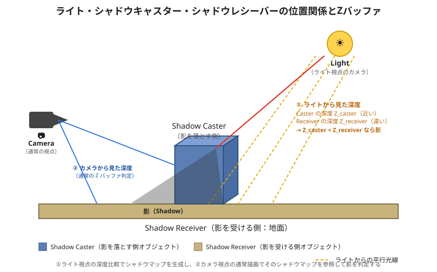
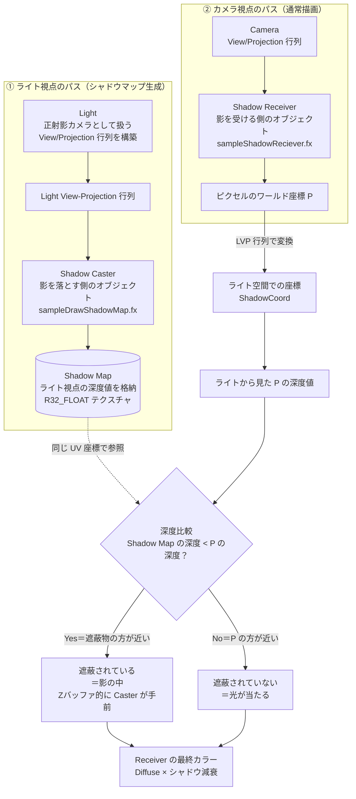
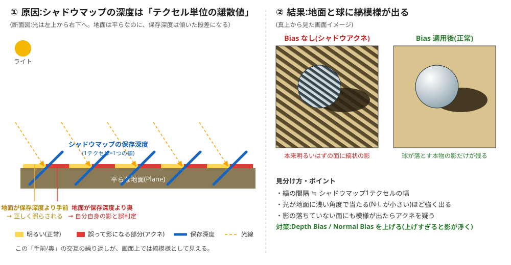

# Chapter 07：シャドウイング（カスケードシャドウマップ）

この章は `URPシェーダープログラミングindex.md` の Chapter 07 に対応します。Chapter 06 で作成した `Transparent06.shader`（PBR / Cook-Torrance 実装）を出発点に、シャドウの受け取り処理を追加していきます。あわせて、DirectX で実装したカスケードシャドウマップの概念が、Unity / URP でどのように抽象化・自動化されているかを対比しながら解説します。

> この章のカスタムシェーダーは、シャドウ受け取りの主要な計算を学ぶための教材です。すべてのライトタイプ・すべてのシャドウ機能を網羅した URP/Lit と同等の実装ではありません。

## 1. 学習目標

- DirectX で実装したカスケードシャドウマップ（深度比較、カスケード分割、シャドウバイアス）の仕組みを、Unity / URP の機能と対応付けて説明できる
- URP のライト・レンダラー・シェーダーの三者がどのようにシャドウ処理を分担しているかを理解する
- Pipeline Asset のシャドウ設定（カスケード数、分割比率、距離、解像度、バイアス）がレンダリング結果にどう影響するかを把握する
- GameObject 側（Mesh Renderer / Light / レイヤー）の設定だけで、シャドウを落とす側・受ける側を制御できるようになる
- `Transparent06.shader` にシャドウ受け取り処理を追加し、ShadowCoord の生成からシャドウアテニュエーションの反映までを自作できる
- 通常の Forward レンダリングのパイプラインの中に、シャドウ計算がどのタイミングで組み込まれているかを説明できる

## 2. DirectX で実装したカスケードシャドウマップの復習

Unity 側の学習に入る前に、前期の DX12 実装で扱ったカスケードシャドウマップの要点を振り返ります。Unity / URP の自動化された機能が、内部的に同じ考え方を踏襲していることを確認するための前提知識の整理です。

### 2.1 シャドウマップの基本原理

ライト視点から深度を記録し、カメラ視点のピクセルをライト空間へ変換して深度比較を行うことで「遮蔽されているか」を判定する、シャドウマッピングの基本アルゴリズムを振り返ります。ライト view/projection 行列の構築、深度のみを書き込むパス、シャドウマップテクスチャの解像度と精度の関係を整理します。

サンプル実装（`Sample_11_06/main.cpp`）では、シャドウを落とす側のモデルを `sampleDrawShadowMap.fx` で描画してシャドウマップへ深度を焼き込み（`InitShadowCaster`）、シャドウを受ける側のモデルは `sampleShadowReciever.fx` でそのシャドウマップをテクスチャとして参照します（`InitShadowReciever`）。これは Chapter 05〜06 で扱ってきた「マテリアルごとに異なる `.fx` / `.shader` を割り当てる」という考え方と同じで、URP で言えば `ShadowCaster` Pass と `UniversalForward` Pass の役割分担に相当します。ライトのカメラは `Camera::enUpdateProjMatrixFunc_Ortho` で正射影に設定され（`InitLightCamera`）、ディレクショナルライトのシャドウマップが平行光源用の正射影行列で生成されることを確認できます。

以下に、まず 3D 空間上でライト・シャドウキャスター・シャドウレシーバー・Z バッファ（深度比較）がどのような位置関係にあるかをイラストとして図解します。



このイラストからわかるように、ライトは「上空にあるもう一つのカメラ」として扱われ、①のライト視点では Shadow Caster（影を落とす側）の深度値が、その背後にある Shadow Receiver（影を受ける側）の深度値より小さい（近い）という位置関係が、影が落ちる条件そのものになります。一方で②の通常のカメラ視点でも、同じオブジェクトに対して独立した Z バッファ（前後判定）が生成されており、カメラ視点の深度比較（通常の不透明物の描画）と、ライト視点の深度比較（シャドウマップの生成・参照）は、同じ「視点から見た深度の前後判定」という原理を、異なる視点（カメラとライト）に対してそれぞれ適用しているだけである、という点が次の図で詳しく解説する内容につながります。

以下に、ライト・シャドウキャスター・シャドウレシーバー・Z バッファ（深度値）の関係を図解します。



この図のポイントは、通常のカメラが使う **Zバッファ（深度比較によるオクルージョン判定）** と、シャドウマップが使う **ライト視点の深度比較** が、同じ「深度を書き込んで比較する」という原理を異なる視点（カメラ／ライト）に適用しているだけである、という点です。Shadow Caster はライト視点での深度（Shadow Map）を生成する役割、Shadow Receiver はその深度と自分のピクセルのライト空間深度を比較して影を判定する役割を持ち、この二つの視点の深度比較が組み合わさることでシャドウが成立します。

### 2.2 カスケード分割（Cascaded Shadow Maps）の考え方

単一のシャドウマップではカメラ近傍から遠方まで均一な解像度を確保できないため、視錐台（View Frustum）をカメラからの距離で複数の領域（カスケード）に分割し、それぞれに専用のシャドウマップを割り当てる手法を復習します。分割距離の決め方（均等分割・対数分割・実用的な折衷案）と、カスケードごとのテクセル密度の違いを扱います。

サンプル実装では `NUM_SHADOW_MAP`（= 3）個のシャドウマップを用意し、`cascadeAreaTbl` というテーブルでカメラの Near 側から Far 側までの距離を複数の区間（エリア）に分割しています。描画ループは `areaNo` を 0 から `NUM_SHADOW_MAP - 1` まで回し、各エリアごとに次の処理を行う構成になっています。

```cpp
float nearDepth = g_camera3D->GetNear();
for (int areaNo = 0; areaNo < NUM_SHADOW_MAP; areaNo++)
{
    // エリアを内包する視錐台の8頂点を求める
    // 8頂点を変換して最大値、最小値を求める
    // クロップ行列を求める
    // ライトビュープロジェクション行列にクロップ行列を乗算する
    // シャドウマップにレンダリング
    nearDepth = cascadeAreaTbl[areaNo]; // 次のエリアの近平面までの距離を代入する
}
```

この「1 エリア分の視錐台を切り出し、専用のシャドウマップへレンダリングする」という処理を 3 回繰り返すのがカスケードシャドウマップの骨格です。URP の Pipeline Asset で設定する Cascade Count・Split はまさにこの `NUM_SHADOW_MAP` と `cascadeAreaTbl` に相当し、Unity 側ではこの視錐台分割とシャドウマップ生成をエンジン内部で自動的に行っています。

### 2.3 DirectX 実装における深度比較とシャドウバイアス

シャドウマップの深度とピクセルの深度を比較する際に発生するシャドウアクネ（自己遮蔽によるノイズ）と、それを抑えるための Depth Bias / Slope-Scaled Bias の設定、さらに補正過多で起きるピーターパンニング（影が物体から浮く現象）とのトレードオフを確認します。

サンプル実装でカラーバッファのフォーマットを `DXGI_FORMAT_R32_FLOAT` に変更している点（`modelInitData.m_colorBufferFormat[0]`）は、深度値を直接テクスチャへ書き込んで比較する「デプスシャドウ」方式であることを示しています。カスケードを導入すると、エリアの境界付近でどちらのカスケードの深度値・バイアス量を使うかによって見た目の継ぎ目（アクネやパンニングの度合いの違い）が生じやすくなるため、カスケードごとにバイアス量を調整する必要がある点も合わせて押さえておきます。

シャドウアクネは、シャドウマップの1テクセルが実際のシーン上である程度の面積を覆っているため、本来なめらかな斜面であってもテクセル単位で深度が離散化され、ピクセルの深度とわずかにズレてしまうことが原因です。特に、ライトに対してほぼ水平な面（法線とライト方向のなす角が大きい面）ほどこのズレが拡大しやすく、縞模様状のノイズとして現れます。


以下に、バイアスなしの場合にシャドウアクネが発生する様子と、バイアスを適用して解消する様子を図解します。



このイラストの左側のように、斜面自身がライトから見て「自分の少し手前にある自分自身」によって遮蔽されたと誤判定されるのがシャドウアクネです。これを数式で表すと、シャドウマップから読み取った深度を `shadowMapDepth`、比較対象となるピクセル自身のライト空間深度を `pixelDepth` としたとき、通常の深度比較は次のようになります。

```
isInShadow = (shadowMapDepth < pixelDepth);
```

`shadowMapDepth` はテクセル単位で離散化された値であるため、本来 `shadowMapDepth == pixelDepth` となるべき自己遮蔽のない面でも、量子化誤差によって `shadowMapDepth` がわずかに `pixelDepth` より小さい値になってしまうことがあります。これがアクネの直接の原因です。バイアスは、この比較そのものに加える「許容量」として与える値であり、具体的には次のように `pixelDepth` 側（またはこれと等価に `shadowMapDepth` 側）へオフセットを加えた上で比較を行います。

```
isInShadow = (shadowMapDepth < pixelDepth - bias);
```

つまり、Depth Bias は「ライト視点での深度比較の閾値に加える定数オフセット」であり、Slope-Scaled Bias は、このオフセット量を固定値ではなく、面の傾き（法線とライト方向のなす角が大きいほど量子化誤差が拡大することを踏まえ、その傾きに比例した値）として動的に計算したものです。右側の図のように、適切な bias を加えることで「自分自身とほぼ同じ深度にあるもの」は遮蔽物とみなさなくなり、アクネが解消されます。ただし Bias を大きくしすぎると、今度は本来接地しているはずの影の付け根が浮いて見える「ピーターパンニング」が発生するため、アクネとパンニングの中間点を実機で確認しながら決める必要があります。カスケードシャドウではカスケードごとに1テクセルあたりがカバーする実距離（テクセル密度）が異なるため、全カスケードで同じ Bias 値を使うと、近いカスケードでは足りず、遠いカスケードでは過剰になりがちです。そのため、カスケードごとに Bias を調整する、あるいはテクセルサイズに応じて Bias をスケーリングする実装がしばしば必要になります。

## 3. Unity / URP におけるシャドウシステムの全体像

DirectX で手動実装していたシャドウマップ生成・カスケード管理・バイアス調整が、URP ではレンダーパイプライン側にどこまで吸収されているかを俯瞰します。

### 3.1 ShadowCasterPass と MainLightShadowCasterPass

URP がシャドウマップを生成する専用パス（Main Light 用の `MainLightShadowCasterPass`、Additional Light 用の `AdditionalLightsShadowCasterPass`）の役割と、シェーダー内の `ShadowCaster` Pass タグとの関係を解説します。DirectX における「深度のみを書き込むパス」が、URP ではどのクラス・どの LightMode に対応するかを対比します。

URP では、シーンのレンダリングが始まると `ScriptableRenderer` がいくつかの `ScriptableRenderPass` を順に実行します。シャドウマップの生成を担当するのが `MainLightShadowCasterPass`（ディレクショナルライト用）と `AdditionalLightsShadowCasterPass`（ポイント/スポットライト用）で、これらは通常の `UniversalForward` のパスよりも前に実行され、シーン内の `Cast Shadows` が有効なオブジェクトだけを対象にライト視点で深度を書き込みます。この処理は、サンプル実装で `sampleDrawShadowMap.fx` を使って個別に描画していた処理と同じ役割であり、URP ではシェーダー側に `Tags { "LightMode" = "ShadowCaster" }` を持つ Pass を用意しておくだけで、このパスがどのライトのどのカスケードに対しても自動的に呼び出されるようになっています。つまり DirectX 実装で `InitShadowCaster` として明示的に書いていた「シャドウマップ専用の描画ループ」が、URP では LightMode タグを介した規約（コンベンション）に置き換わっている、と理解すると対応がつきやすくなります。

### 3.2 URP のカスケード設定（Pipeline Asset の Shadows セクション）

Universal Render Pipeline Asset

Pipeline Asset の Lighting > Shadows セクションには、主に次のような項目が並んでいます。

- `Max Distance`：カメラからどこまでの距離をシャドウ描画の対象にするか（この距離を超えると影が描画されなくなる）
- `Cascade Count`：カスケードの数（1〜4）
- `Depth Attenuation`（Distance Fade）：Max Distance 付近で影をフェードアウトさせ、消失時の境界を目立たなくする割合
- カスケードごとの `Split` 値：視錐台をどの比率で分割するか
- `Depth Bias` / `Normal Bias`：法線方向・深度方向のオフセット量
- `Soft Shadows`：PCF 的なぼかしサンプリングの有効化

これらは、サンプル実装で言えば `NUM_SHADOW_MAP`（Cascade Count に相当）、`cascadeAreaTbl`（Split に相当）、シャドウマップ比較時に加算していたオフセット値（Depth/Normal Bias に相当）を、スクリプトを書かずに Inspector から調整できるようにしたものです。DirectX 実装ではこれらの値をソースコードの定数や構造体として管理していましたが、URP では Pipeline Asset という ScriptableObject にシリアライズされており、実行時にアセットを切り替えるだけで異なるシャドウ品質設定（PCやモバイル向けなど）を使い分けられる点が大きな違いです。

### 3.3 シャドウカスケードの分割比率とカスケード数

カスケード数（1〜4）と分割比率スライダーの意味

Cascade Count を増やすほど、視錐台をより細かい区間に分割できるため、近景のシャドウ解像度を保ちながら遠景まで影を届かせやすくなりますが、その分シャドウマップの生成コスト（ドローコール数、Atlas の使用量）も増加します。分割比率スライダー（2 Cascades なら1つ、4 Cascades なら3つのスライダー）は、Max Distance を100%として、そのうちどこまでを何番目のカスケードに割り当てるかを表しており、サンプル実装の `cascadeAreaTbl` に収められている「各エリアの Near 側の距離」と同じ役割を持ちます。一般的には、近いカスケードほど狭い範囲を高解像度で、遠いカスケードほど広い範囲を低解像度でカバーするように、分割比率を手前に寄せる（対数分割に近づける）設定がよく使われます。これは、人間の目が近くのオブジェクトの影のジャギーには敏感である一方、遠くの影の解像度低下には気づきにくいという視覚特性を踏まえた調整です。光源の角度（太陽の高度）が変わると、同じカスケード分割でもライト視点の視錐台の形状が変化するため、浅い角度の光ではカスケードの境界がより目立ちやすくなる点にも注意が必要です。

### 3.4 シャドウ解像度・距離・バイアスのパラメータ

Shadow Resolution（Atlas 解像度）

Shadow Resolution は、すべてのカスケード（および Additional Light 分）のシャドウマップをまとめて格納する1枚の Atlas テクスチャの解像度を指定します。Cascade Count を増やしても Atlas 解像度が据え置きであれば、1カスケードあたりに割り当てられるテクセル数は減ってしまうため、カスケード数と Atlas 解像度はセットで調整する必要があります。Max Distance を伸ばすと、より遠くまで影が届く代わりに、各カスケード（特に最遠カスケード）がカバーする実距離が伸び、テクセル密度が下がってシャドウの輪郭が粗くなります。Distance Fade は、この Max Distance の境界で影が突然消えることによる違和感を抑えるため、境界手前から徐々に影を薄くするものです。Depth Bias / Normal Bias は2.3で確認したシャドウアクネ対策・ピーターパンニング対策と全く同じ意味を持ちますが、URP ではカスケードごとに自動でテクセルサイズに応じたスケーリングがある程度行われるため、DirectX 実装のように全カスケードで手動調整する手間は軽減されています。とはいえ、極端に Bias を上げ下げすると、依然としてアクネやパンニングが発生するため、2.3で学んだトレードオフの考え方自体は変わりません。

## 4. GameObject 側の設定（落とす側・受ける側）

シェーダーを変更しなくても、GameObject・Light 側の設定だけでシャドウの挙動を大きく制御できることを解説します。

### 4.1 Mesh Renderer の Cast Shadows / Receive Shadows

Mesh Renderer コンポーネントの `Cast Shadows`（Off / On / Two Sided / Shadows Only）と `Receive Shadows` の各オプションが、ShadowCasterPass への参加可否とシェーダー内でのシャドウ減衰の適用可否にどう対応するかを解説します。

> 注意: URP/Lit では `Receive Shadows` が `_RECEIVE_SHADOWS_OFF` キーワードとして反映されますが、自作シェーダーでは `#pragma shader_feature_local_fragment _RECEIVE_SHADOWS_OFF` を宣言し、キーワード有効時に `shadowAttenuation` を 1 にする処理を自分で書かない限り連動しません。`Shadow07.shader` では実装しないため、`Receive Shadows` の設定に関わらず影を受けます。

`Cast Shadows` を `Off` にしたオブジェクトは

### 4.2 Light コンポーネントのシャドウ設定

Light コンポーネントの `Shadow Type`（No Shadows / Hard Shadows / Soft Shadows）、Strength、Bias、Normal Bias、Near Plane などの設定項目と、それらが Pipeline Asset 側のグローバル設定とどう組み合わさるかを整理します。

`Shadow Type` を `No Shadows` にすると、そのライトはどのオブジェクトからもシャドウマップが生成されなくなり、`MainLightShadowCasterPass` 自体がスキップされます。`Hard Shadows` / `Soft Shadows` の違いは、シャドウマップ参照時に1テクセルだけをサンプリングするか、PCF による複数サンプルの平均（ぼかし）を行うかという点にあり、品質設定側の Soft Shadows 対応状況と連動します。`Strength` は影の濃さ（0で影なし、1で完全な黒影）を表す係数で、シェーダー側ではシャドウアテニュエーションにこの値を乗算する形で反映されます。`Bias` / `Normal Bias` はライトごとに個別設定できる値で、Pipeline Asset 側の Depth/Normal Bias と合算、または優先されて最終的なオフセット量が決まります。`Near Plane` はライトカメラの Near 面の位置を指定するもので、サンプル実装で `lightCamera.SetNear(1.0f)` としていた値に相当し、近すぎる値だとシャドウマップの深度精度が不足し、遠すぎる値だと近くの Caster がクリップされてしまう点に注意が必要です。

### 4.3 レイヤーとシャドウ（Culling Mask / Shadow Layer Mask）

Light の Culling Mask によって「どのレイヤーのオブジェクトに影響するか」を制御する仕組みと、シャドウ専用の Layer Mask 設定を使って、通常の描画とは別にシャドウの落とす対象・受ける対象を絞り込む方法を解説します。

Light コンポーネントの `Culling Mask` は、そのライトが「どのレイヤーのオブジェクトを照らすか」を制御するプロパティで、ここから除外されたレイヤーのオブジェクトはライティング計算自体の対象外になります。これとは別に、URP の一部のライトには「Shadow Layer Mask」に相当する設定があり、通常のライティング対象には含めつつ、シャドウマップへの寄与（Caster として扱うか、Receiver として扱うか）だけを別のレイヤー条件で絞り込むことができます。これにより、例えば「UI 的に表示される専用オブジェクトは通常光を受けるが影は落とさない」「特定のデバッグ用レイヤーは常に影の対象から除外する」といった、Mesh Renderer 単位の設定よりも粗い粒度（レイヤー単位）でのシャドウ制御が可能になります。DirectX 実装では、Caster/Receiver をモデルごとに別々の `.fx` と `Init〜` 関数で明示的に分けていましたが、URP ではレイヤーという分類軸を使うことで、同じ考え方をシーン全体に対して宣言的に適用できます。

### 4.4 Light Layers を使った部分的なシャドウ制御

URP の Rendering Layers（旧 Light Layers）を使い、特定のオブジェクトだけを特定のライトの影響下に置く、より細かい粒度のシャドウ制御について解説します。シーン内で意図的に影を落とさない・受けないオブジェクトを作る際の設定手順を扱います。

Rendering Layers は、GameObject 側に設定する「レンダリングレイヤーマスク」と、Light 側に設定する「このライトが影響を与えるレンダリングレイヤー」を突き合わせることで、通常の Unity レイヤー（Culling Mask で使われるもの）とは独立したもう一つの分類軸を提供します。これを使うと、同じ Unity レイヤーに属するオブジェクト同士でも、「このオブジェクトだけは特定のライトのシャドウから除外する」「このライトの影だけを特定のオブジェクト群にのみ落とす」といった、Mesh Renderer の Cast/Receive Shadows の設定よりもさらに柔軟な制御が行えます。設定手順としては、Graphics Settings でレンダリングレイヤー名を定義し、対象の Renderer コンポーネントと Light コンポーネントの双方で該当するレイヤーにチェックを入れる、という流れになります。演出上「特定のキャラクターにだけ専用のスポットライトで影を落としたい」といったケースで活用します。

## 5. シェーダー側でシャドウを受け取る仕組み

ここからは、GameObject 設定だけではカバーできない、シェーダー内部でのシャドウ受け取り処理を解説します。DirectX での深度比較処理が URP の HLSL マクロ・関数へどう置き換わるかが中心テーマです。

### 5.1 ShadowCoord の生成（頂点シェーダーでの座標変換）

頂点シェーダーでワールド座標からシャドウ座標（ライト空間での UV + 深度）を計算する `TransformWorldToShadowCoord` などの URP ユーティリティ関数と、カスケードごとのシャドウ空間への変換処理を解説します。

`float4 shadowCoord : TEXCOORD4` のようなセマンティクス（7.2 参照。`TEXCOORD_SHADOWCOORD` というセマンティクスは存在しません）

### 5.2 `MainLightRealtimeShadow` とシャドウアテニュエーション

生成した ShadowCoord を使って実際にシャドウマップをサンプリングし、遮蔽度（アテニュエーション値）を得る `MainLightRealtimeShadow` などの関数の内部処理を解説します。DirectX で自作していた深度比較・PCF（Percentage Closer Filtering）サンプリングとの対応関係を示します。

`MainLightRealtimeShadow(shadowCoord)` は、ShadowCoord の UV 座標でシャドウマップ（Atlas）をサンプリングし、格納されている深度値と ShadowCoord 自身が持つ深度値を比較して、0（完全に遮蔽）から1（遮蔽なし）までのアテニュエーション値を返します。Soft Shadows が有効な場合は、1回のサンプリングではなく、UV 座標の周囲を複数回（3x3 や 5x5 のカーネルで）サンプリングしてその平均を取る PCF 処理が内部で行われ、影の境界をぼかして柔らかく見せます。これは、DirectX 実装の PCF（Percentage Closer Filtering）サンプリングで学んだ「深度比較を1点ではなく複数点で行い、結果を平均することでソフトシャドウを得る」という考え方と全く同じです。DirectX では PCF のサンプリング回数やオフセット量を自前で `for` ループとして実装しましたが、URP では `SAMPLE_TEXTURE2D_SHADOW` 系のマクロやハードウェア PCF（比較サンプラー）を使うことで、この処理が最適化された形で自動的に行われます。

### 5.3 カスケード間のブレンディングとソフトシャドウ

複数カスケードの境界で発生するシャドウの継ぎ目を目立たなくするブレンディング処理と、Soft Shadows 設定時に行われる PCF/PCSS 的なぼかし処理の概要を解説します。

あるピクセルが2つのカスケードの境界付近にある場合、どちらのカスケードを採用するかを単純な距離の閾値だけで切り替えると、わずかに異なる解像度・バイアス量の影響で継ぎ目が視認されることがあります。URP では `_MAIN_LIGHT_SHADOWS_CASCADE` キーワードが有効なとき、境界付近で隣接する2つのカスケードのシャドウ判定結果を一定の距離範囲でブレンド（線形補間）することで、この継ぎ目を目立たなくする処理が組み込まれています。これは、DirectX 実装でカスケードを3枚用意しても境界のジャギー対策が別途必要になる、という課題に対する URP 側の回答に相当します。また、Soft Shadows による PCF ぼかしは各カスケード内で独立して行われるため、カスケードブレンディングとソフトシャドウは別々の仕組みとして組み合わさっている点も押さえておくとよいでしょう。

### 5.4 Additional Light のシャドウ対応

Point Light・Spot Light などの Additional Light がシャドウを落とす場合の処理（Additional Light 用シャドウアトラス、`AdditionalLightRealtimeShadow` 関数）について、Main Light との違いを中心に解説します。

Main Light（通常はディレクショナルライト1つ）のシャドウはカスケード分割された複数枚のシャドウマップを使いますが、Additional Light（Point/Spot）のシャドウは `AdditionalLightsShadowCasterPass` によって、ライトごとに1枚（Spot）または複数面相当のキューブマップ的な範囲（Point）のシャドウマップが、同じく1枚の Atlas テクスチャへまとめて格納されます。シェーダー側では、処理対象のライトインデックスに応じて `AdditionalLightRealtimeShadow(lightIndex, positionWS)` のような関数を呼び出し、その関数の内部で該当するライトの ShadowCoord 算出とシャドウマップサンプリングが行われます。カスケード分割は Main Light（主に広い範囲を均一にカバーする必要があるディレクショナルライト）特有の仕組みであり、Point/Spot Light は影響範囲が限定されるため、通常はカスケードを使わない1枚のシャドウマップで十分というのが大きな違いです。

## 6. 通常の Forward レンダリングとの組み合わせ

Chapter 06 で解説した Forward パスの処理の流れ（頂点処理 → SurfaceData/InputData 構築 → PBR 計算 → Fog/Alpha 出力）に、シャドウ計算がどのタイミングで入り込むかを解説します。

### 6.1 Forward パスにおけるシャドウ計算の位置づけ

`LitPassFragment` 内で `InitializeInputData` が ShadowCoord を含む `InputData` を構築し、その後の `UniversalFragmentPBR` 呼び出しの中でシャドウ減衰が参照される、という処理順序を整理します。Chapter 06 の Forward パス図との接続を明示します。

`LitPassFragment` は、まず `InitializeStandardLitSurfaceData` で Albedo・Metallic・Normal などの `SurfaceData` を構築し、続けて `InitializeInputData` で視線ベクトルや法線、そして頂点シェーダーから渡ってきた ShadowCoord を含む `InputData` を構築します。URP が ShadowCoord を頂点シェーダー側で計算させているのは、ピクセル単位で毎回カスケード判定や行列乗算を行うよりも、頂点単位（そして補間）で済ませたほうが負荷が軽いためです。この `InputData` を引数として `UniversalFragmentPBR` が呼び出されると、関数内部でまず `GetMainLight(inputData.shadowCoord)` が呼ばれ、ここで ShadowCoord から `MainLightRealtimeShadow` を経由したシャドウアテニュエーションが計算されて `Light` 構造体の `shadowAttenuation` フィールドに格納されます。つまり、シャドウ計算そのものは「SurfaceData/InputData を組み立てたあと、PBR のライティング計算の入り口」で行われており、Chapter 06 で確認した Forward パスの流れ（頂点処理 → SurfaceData/InputData 構築 → PBR 計算 → Fog/Alpha 出力）に対して、このタイミングで `shadowAttenuation` を含む `Light` が供給される形で組み込まれます。

### 6.2 UniversalFragmentPBR とシャドウ減衰の合成

直接光の寄与にシャドウアテニュエーションを乗算するタイミングと、Main Light の `Light` 構造体に含まれる `shadowAttenuation` フィールドが、Cook-Torrance などの BRDF 計算結果にどう反映されるかを解説します。

`UniversalFragmentPBR` の内部では、`Light mainLight = GetMainLight(inputData.shadowCoord)` によって得られた `Light` 構造体の `color`・`direction`・`distanceAttenuation`・`shadowAttenuation` を使って、直接光の寄与（`LightingPhysicallyBased` 相当の関数）を計算します。このとき、シャドウアテニュエーションは「この光源からの寄与全体」に対する係数として、距離減衰（`distanceAttenuation`）と同じ扱いで乗算されます。`Transparent06.shader` の `ShadeCookTorrance` 関数は、Cook-Torrance の Specular 項と Diffuse 項を合成して直接光の最終的な寄与を返していましたが、Chapter 07 ではこの関数に渡すライトの強さ（あるいは関数が返した結果）へ、同じようにシャドウアテニュエーションを乗算する処理を追加します。これにより、影の中にあるピクセルでは Cook-Torrance が計算する鏡面反射・拡散反射の両方が暗くなり、間接光（環境光）だけが残るという、物理的にも自然な見た目になります。

### 6.3 Transparent オブジェクトとシャドウの関係

Transparent サーフェスがシャドウを受け取る・落とす際の制約（ZWrite Off でも ShadowCaster Pass は独立して動作すること、半透明物同士のシャドウの扱いの限界など）を、Chapter 06 の Transparent 描画順・深度の説明と関連付けて解説します。

Chapter 06 で確認したように、`Transparent06.shader` の `UniversalForward` Pass は `ZWrite Off` でアルファブレンドを行いますが、`ShadowCaster` Pass はこれとは独立した Pass であり、通常は `ZWrite On` で深度のみを書き込みます。そのため、半透明オブジェクトであっても `Cast Shadows` が有効であれば、見た目が透けているかどうかに関係なく、不透明物と同様にくっきりとした影を落とします（アルファ値に応じて影の濃さを変えるには、`ShadowCaster` Pass 内でアルファテストやクリップを追加する作業が別途必要です）。一方、半透明物同士が重なった場合、シャドウマップには「最初に深度を書き込んだオブジェクトの深度」しか記録されないため、奥の半透明物の影が手前の半透明物の深度によって遮られてしまう、あるいは逆に本来透けて見えるはずの光が完全に遮蔽されてしまうといった、半透明特有の制約が生じます。これは、Chapter 06 で扱った「Transparent は Queue 順に描画されるが深度バッファへの書き込みは行わない」という性質が、シャドウマップ生成という別の深度比較の文脈でも同様の限界として現れることを意味します。

## 7. `Transparent06.shader` から `Shadow07.shader` を作る

ここからは実装パートです。Chapter 06 の完成物である `Transparent06.shader` を複製し、シャドウ受け取り機能を段階的に追加して `Shadow07.shader` を作成します。

### 7.1 変更前後の対応表

`Transparent06.shader` のどの関数・どの Pass をどのように変更するかを、Chapter 06 と同様の対応表形式で示します（`InitializeSurfaceInputs`、`ShadeCookTorrance`、`frag` のうち変更が必要な箇所の一覧）。

| 対象 | Chapter 06（Transparent06） | Chapter 07（Shadow07） |
| --- | --- | --- |
| 頂点出力構造体（Varyings） | ワールド座標・法線・UV などを保持 | `float4 shadowCoord` フィールドを追加 |
| 頂点シェーダー（vert） | ワールド座標・法線変換まで | 末尾で `TransformWorldToShadowCoord` を呼び `shadowCoord` を格納 |
| `InitializeSurfaceInputs` | Albedo/Normal/Metallic 等の取得 | 変更なし |
| `ShadeCookTorrance` | `light.shadowAttenuation` を既に乗算済み | 変更なし（二重乗算を避けるため追加の乗算はしない） |
| `frag` | `GetMainLight()`（常に shadowAttenuation = 1） | `GetMainLight(IN.shadowCoord)` に変更し、影の減衰を有効にする |
| `#pragma` | シャドウ関連の `multi_compile` なし | `_MAIN_LIGHT_SHADOWS*`、`_SHADOWS_SOFT` を追加（7.2 Step 5） |
| `ShadowCaster` Pass | なし（Transparent06 は Forward Pass のみ） | URP/Lit の `ShadowCaster` Pass を追加し、自身も Caster として振る舞えるようにする |

この対応表からわかる通り、変更の中心は「頂点シェーダーで ShadowCoord を1つ追加する」「フラグメントシェーダーでシャドウアテニュエーションを取得し直接光に乗算する」の2点であり、Chapter 06 で組み上げた Cook-Torrance の計算ロジック自体には手を加えません。

### 7.2 ShadowCoord 生成処理の追加

Step By Step で確認します。

**Step 1：必要なインクルードを確認する**

`Transparent06.shader` は、すでに次の2つの `#include` を持っています。

```hlsl
#include "Packages/com.unity.render-pipelines.universal/ShaderLibrary/Core.hlsl"
#include "Packages/com.unity.render-pipelines.universal/ShaderLibrary/Lighting.hlsl"
```

`TransformWorldToShadowCoord` や `MainLightRealtimeShadow` は URP の `Shadows.hlsl` に定義されていますが、この関数は `Lighting.hlsl` から内部的にインクルードされているため、`Shadow07.shader` でも新しく `#include` を追加する必要はありません。Step 1 は「追加なし・変更なし」であることを確認するだけで完了です。

**Step 2：`Varyings` 構造体へ ShadowCoord フィールドを追加する**

`Transparent06.shader` の `Varyings` 構造体は次のようになっています。

```hlsl
struct Varyings
{
    float4 positionHCS : SV_POSITION;
    float3 positionWS : TEXCOORD0;
    half3 normalWS : TEXCOORD1;
    half4 tangentWS : TEXCOORD2;
    float2 uv : TEXCOORD3;
};
```

ここに、シャドウ座標を格納するための `float4 shadowCoord` フィールドを1つ追加します。既存の `TEXCOORD0`〜`TEXCOORD3` を使い切っているため、セマンティクスは次の空き番号である `TEXCOORD4` を割り当てます。

```hlsl
struct Varyings
{
    float4 positionHCS : SV_POSITION;
    float3 positionWS : TEXCOORD0;
    half3 normalWS : TEXCOORD1;
    half4 tangentWS : TEXCOORD2;
    float2 uv : TEXCOORD3;
    float4 shadowCoord : TEXCOORD4; // 追加：ライト空間でのシャドウ座標
};
```

この1行が、頂点シェーダーからフラグメントシェーダーへシャドウ座標を橋渡しするための「容れ物」になります。

**Step 3：頂点シェーダー（`vert`）に計算処理を追加する**

`Transparent06.shader` の `vert` 関数は次のようになっています。

```hlsl
Varyings vert(Attributes IN)
{
    Varyings OUT;
    OUT.positionWS = TransformObjectToWorld(IN.positionOS.xyz);
    OUT.positionHCS = TransformWorldToHClip(OUT.positionWS);
    OUT.normalWS = TransformObjectToWorldNormal(IN.normalOS);
    OUT.tangentWS = half4(TransformObjectToWorldDir(IN.tangentOS.xyz), IN.tangentOS.w * GetOddNegativeScale());
    OUT.uv = TRANSFORM_TEX(IN.uv, _BaseMap);
    return OUT;
}
```

`OUT.positionWS` が確定した直後に、次の1行を追加します。

```hlsl
Varyings vert(Attributes IN)
{
    Varyings OUT;
    OUT.positionWS = TransformObjectToWorld(IN.positionOS.xyz);
    OUT.positionHCS = TransformWorldToHClip(OUT.positionWS);
    OUT.normalWS = TransformObjectToWorldNormal(IN.normalOS);
    OUT.tangentWS = half4(TransformObjectToWorldDir(IN.tangentOS.xyz), IN.tangentOS.w * GetOddNegativeScale());
    OUT.uv = TRANSFORM_TEX(IN.uv, _BaseMap);
    OUT.shadowCoord = TransformWorldToShadowCoord(OUT.positionWS); // 追加：ShadowCoord の生成
    return OUT;
}
```

この1行が実装している内容は、5.1 で解説した通り、(1) 現在の頂点がどのカスケードに属するかを View 空間の深度から判定し、(2) 該当するカスケードのライトビュープロジェクション行列（`_MainLightWorldToShadow` 配列の要素）を選択し、(3) ワールド座標 `positionWS` にその行列を乗算してライト空間の UV 座標・深度を算出する、という3つの処理です。DirectX 実装で言えば、カスケード描画ループ内で行っていた「クロップ行列を乗算したライトビュープロジェクション行列をワールド座標に適用する」処理に相当します。

**Step 4：ここまでの差分のまとめ**

| 変更箇所 | Transparent06.shader | Shadow07.shader |
| --- | --- | --- |
| インクルード | `Core.hlsl` / `Lighting.hlsl` のみ | 変更なし（`Shadows.hlsl` は `Lighting.hlsl` 経由で利用可能） |
| `Varyings` 構造体 | `TEXCOORD0`〜`TEXCOORD3` の4フィールド | `float4 shadowCoord : TEXCOORD4` を追加 |
| `vert` 関数 | ワールド座標・法線・UV の変換のみ | 末尾に `OUT.shadowCoord = TransformWorldToShadowCoord(OUT.positionWS);` を追加 |

この時点では、ShadowCoord を計算して `Varyings` へ格納しているだけで、まだこの値をどこにも使っていません。そのため、`Shadow07.shader` をこの段階でビルドしてシーンに適用しても、見た目は `Transparent06.shader` と変わらず、影はまだ反映されません。次の 7.3 で、フラグメントシェーダー側がこの `shadowCoord` を実際に参照し、シャドウアテニュエーションとして直接光の計算に反映させます。

**Step 5：シャドウ用の `multi_compile` を追加する**

UniversalForward Pass の既存の `#pragma multi_compile` の並びに、次の行を追加します。これが無いと影の計算が無効化され、`MainLightRealtimeShadow` は常に 1 を返して影が出ません。

```hlsl
#pragma multi_compile _ _MAIN_LIGHT_SHADOWS _MAIN_LIGHT_SHADOWS_CASCADE _MAIN_LIGHT_SHADOWS_SCREEN
#pragma multi_compile_fragment _ _SHADOWS_SOFT
```

### 7.3 シャドウアテニュエーションの取得と反映

Chapter 06 の `ShadeCookTorrance` は `light.shadowAttenuation` をすでに `radiance` へ乗算しています。ただし `GetMainLight()`（引数なし）では `shadowAttenuation` が常に 1 になるため、Chapter 06 では影が効きません。そこで `frag` 内の Main Light の取得を、`shadowCoord` を渡す形へ変更するだけで影が有効になります。

```hlsl
// 変更前
color += ShadeCookTorrance(GetMainLight(), surface, N, V);

// 変更後
Light mainLight = GetMainLight(IN.shadowCoord);
color += ShadeCookTorrance(mainLight, surface, N, V);
```

> 注意: `MainLightRealtimeShadow` の結果を `ShadeCookTorrance` の戻り値へ別途乗算すると、関数内の乗算と合わせて二重適用になり、影が過剰に暗くなります。乗算は `ShadeCookTorrance` 内の 1 箇所だけにしてください。

環境光 `ambientDiffuse` は影の対象に含めません。影は直接光の遮蔽を表すため、環境光まで暗くすると影の中が不自然に真っ黒になります。Additional Light の影は 5.4 のとおり別の呼び出し（シャドウ用の引数付き）が必要で、本章では Main Light のみ対応します。

（Chapter06.md は同様に修正済み）

### 7.3.1 ShadowCaster Pass の追加

7.1 の表のとおり、Transparent06 は Forward Pass のみで、影を受けることはできても落とすことはできません。自身を Caster にするため、SubShader 内（Forward Pass の後）へ次の Pass を追加します。

```hlsl
Pass
{
    Name "ShadowCaster"
    Tags { "LightMode"="ShadowCaster" }
    ZWrite On
    ZTest LEqual
    ColorMask 0
    Cull Back

    HLSLPROGRAM
    #pragma vertex ShadowPassVertex
    #pragma fragment ShadowPassFragment
    #include "Packages/com.unity.render-pipelines.universal/ShaderLibrary/Core.hlsl"
    #include "Packages/com.unity.render-pipelines.universal/ShaderLibrary/Shadows.hlsl"

    float3 _LightDirection;
    float3 _LightPosition;

    struct ShadowAttributes { float4 positionOS : POSITION; float3 normalOS : NORMAL; };
    struct ShadowVaryings { float4 positionCS : SV_POSITION; };

    ShadowVaryings ShadowPassVertex(ShadowAttributes input)
    {
        float3 positionWS = TransformObjectToWorld(input.positionOS.xyz);
        float3 normalWS = TransformObjectToWorldNormal(input.normalOS);
    #if _CASTING_PUNCTUAL_LIGHT_SHADOW
        float3 lightDirectionWS = normalize(_LightPosition - positionWS);
    #else
        float3 lightDirectionWS = _LightDirection;
    #endif
        ShadowVaryings output;
        output.positionCS = TransformWorldToHClip(ApplyShadowBias(positionWS, normalWS, lightDirectionWS));
        return output;
    }

    half4 ShadowPassFragment(ShadowVaryings input) : SV_TARGET { return 0; }
    ENDHLSL
}
```

この ShadowCaster は Alpha を参照しないため、半透明でも影はくっきり落ちます（6.3）。Alpha に応じて抜く場合は、頂点出力に UV を追加して `ShadowPassFragment` で `clip` を行います。URP のバージョンによっては `ApplyShadowClamping` が必要・利用可能な場合がありますが、本教材では使用しません。
### 7.4 完成シェーダーの確認

完成した `Shadow07.shader` をシーンに適用し、Chapter 06 の `Transparent06` との見た目の違い（影の有無、ソフトシャドウの効き具合）を比較して確認する手順をまとめます。

`Shadow07` マテリアルを適用したオブジェクトを、影を落とす別のオブジェクト（例えば Plane の上に浮かせた Cube）の下に配置し、Game ビューおよび Scene ビューで影が描画されることを確認します。このとき `Transparent06` マテリアルのオブジェクトと並べて配置すると、同じ半透明表現でありながら片方には影が落ち、もう片方には落ちない（または両方に落ちるが Shadow07 側だけが影を受け取る）という違いを直接比較できます。さらに、Light コンポーネントの `Shadow Type` を `Hard Shadows` と `Soft Shadows` で切り替え、影の輪郭のシャープさの違いを観察することで、5.2 で学んだ PCF サンプリングの効果を実機で確認します。

## 8. 実習

ここまでの内容を踏まえ、実際にシーンを構築しながらシャドウ設定とシェーダー実装を体験する実習を行います。

### 8.1 シーン構築（落とす側・受ける側オブジェクトの配置）

付属アセット（`10yen.fbx` など）を使い、影を落とすオブジェクトと受けるオブジェクト（Plane や Cube）を配置し、`Shadow07` マテリアルを適用してシャドウが描画されることを確認します。

まずシーンに Plane を配置して地面とし、その上空に `10yen.fbx` などの付属モデルを浮かせて配置します。地面側の Mesh Renderer には `Receive Shadows` が有効な `Shadow07` マテリアルを割り当て、浮かせたモデル側の Mesh Renderer には `Cast Shadows` が `On` になっていることを確認します。Directional Light の角度を変えながら Game ビューを確認し、モデルの影が地面に投影されること、モデルを動かすと影の位置・形状が追従することを確認します。影が描画されない場合は、まず Mesh Renderer の Cast/Receive Shadows の設定、次に Light の Shadow Type が `No Shadows` になっていないか、最後にマテリアルが正しく `Shadow07` になっているかの順に確認すると原因を切り分けやすくなります。

### 8.2 カスケード設定を変更した際の見た目の変化の観察

Pipeline Asset のカスケード数・分割比率・Max Distance を変更しながら、シャドウの境界や遠景での消失具合がどう変化するかを観察し、3.3・3.4 で学んだ内容と対応付けます。

まず Cascade Count を 1 から 4 へ段階的に増やし、遠くに配置したオブジェクトの影の輪郭（ジャギーの粗さ）がどう変化するかを比較します。次に分割比率スライダーを極端に手前寄り・奥寄りに変更し、近景と遠景それぞれのシャドウ品質がどうトレードオフになるかを確認します。最後に Max Distance を小さくしてカメラから少し離れた位置で影が消失する様子と、Distance Fade の値を変えてその消失の境界が滑らかになる様子を見比べます。これらの観察結果を、3.3・3.4 で解説したテクセル密度・分割比率の考え方と照らし合わせることで、Inspector 上の数値操作がシャドウマップの内部処理にどうつながっているかを体感できます。

### 8.3 シャドウバイアス・ピーターパンニングの確認と調整

Depth Bias / Normal Bias の値を意図的に変化させ、シャドウアクネとピーターパンニングのどちらが発生するかを観察し、2.3 で復習した DirectX 実装時のトレードオフと同じ現象であることを確認します。

Depth Bias を 0 に近い値まで下げると、平面上やわずかに湾曲した面にノイズ状の影（シャドウアクネ）が現れることを確認します。逆に Depth Bias を大きくしすぎると、本来地面に接しているはずのオブジェクトの足元の影が、オブジェクトから離れた位置にずれて浮いて見える現象（ピーターパンニング）が確認できます。Normal Bias についても同様に、値を変化させながら法線方向のオフセットが影の輪郭にどう影響するかを観察します。この実習を通じて、2.3 で学んだ「Depth Bias を上げるとアクネは減るがパンニングが増える」というトレードオフが、DirectX の手動実装だけでなく URP の自動化されたシステムでも全く同じ原理で発生していることを、実際の見た目として確認できます。

## 9. まとめ

DirectX で手動実装していたカスケードシャドウマップの各要素（シャドウマップ生成、カスケード分割、深度比較、バイアス調整）が、Unity / URP ではパイプライン・GameObject 設定・シェーダーコードの三層にどう分担されているかを振り返り、章全体の要点を整理します。

DirectX 実装では、シャドウマップ生成（`InitShadowCaster` とライト視点の描画ループ）、カスケード分割（`NUM_SHADOW_MAP` と `cascadeAreaTbl`）、深度比較（`sampleShadowReciever.fx` 内の比較処理）、バイアス調整（Depth Bias / Slope-Scaled Bias の値）のすべてを、1つのプロジェクトのソースコードとして自分で書く必要がありました。これに対して URP では、同じ4つの要素が次の三層に分担されています。1つ目はレンダーパイプライン層で、`MainLightShadowCasterPass` がシャドウマップ生成とカスケード分割を、Pipeline Asset の Shadows セクションがカスケード数・解像度・距離・バイアスの数値管理を担当します。2つ目は GameObject・Light 設定層で、Mesh Renderer の `Cast Shadows`/`Receive Shadows`、Light の `Shadow Type`・Bias・Culling Mask、Rendering Layers が、どのオブジェクトがシャドウの生成・受け取りに参加するかを宣言的に制御します。3つ目がシェーダーコード層で、`TransformWorldToShadowCoord` によるシャドウ座標の生成と、`MainLightRealtimeShadow` によるシャドウアテニュエーションの取得・反映が、`Shadow07.shader` のようなカスタムシェーダー内に数行のコードとして組み込まれます。

この三層分担により、エンジンが担うべき汎用的な処理（深度比較のサンプリング、カスケードの選択とブレンディング、PCF によるソフトシャドウ）はブラックボックス化されたユーティリティ関数に任せつつ、教材として重要な「シャドウ座標の生成」と「シャドウ減衰の直接光への反映」という2箇所だけを自作することで、DirectX で学んだカスケードシャドウマップの原理をそのまま URP のシェーダー実装へ接続できることが、この章全体を通じて確認できたはずです。次章以降では、ここで組み込んだシャドウ受け取り処理を踏まえ、さらに発展的なライティング・マテリアル表現を扱っていきます。
