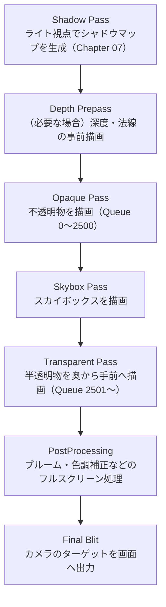
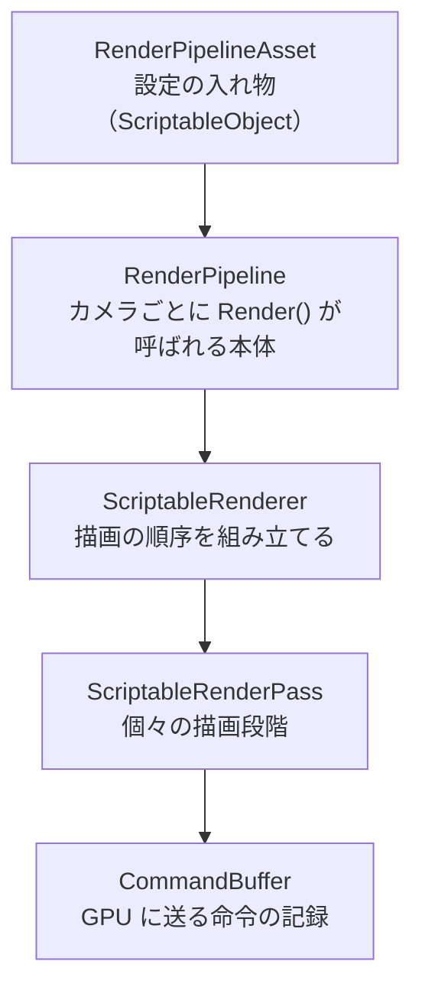
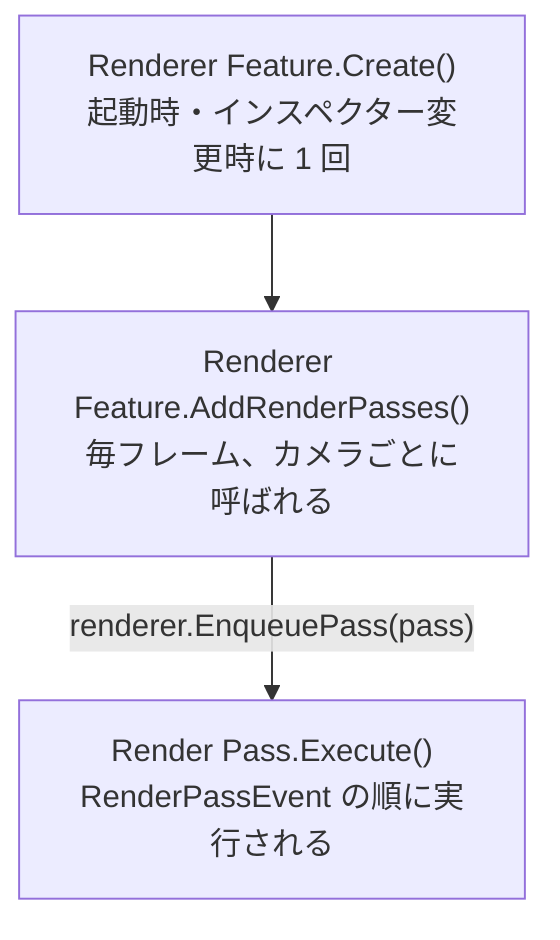
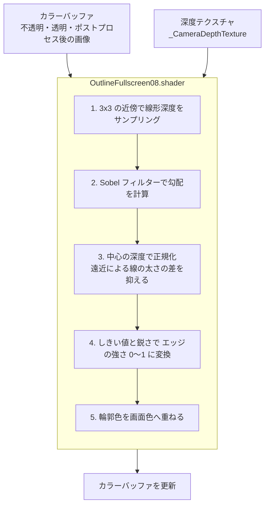
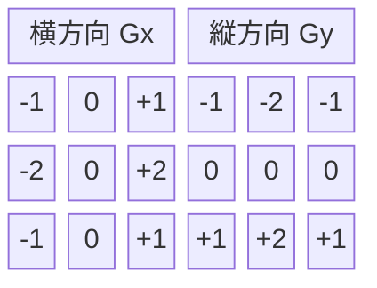
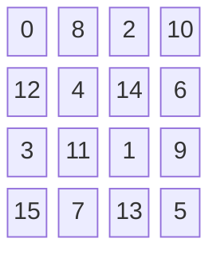
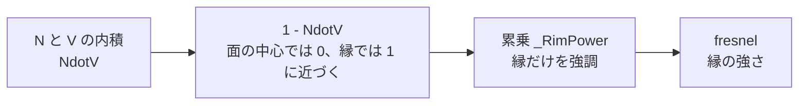
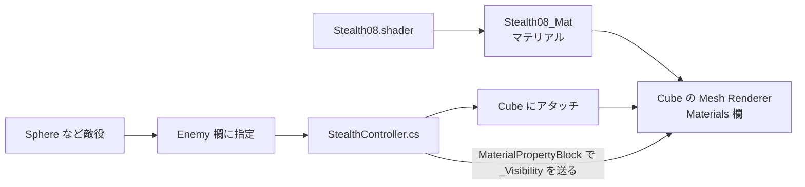

# Chapter 08：Scriptable Render Pass と特殊効果（輪郭線・ディザリング透過・ステルス）

この章は `URPシェーダープログラミングindex.md` の Chapter 08 に対応します。Chapter 07 までは「マテリアルのシェーダーで物体ごとの見た目を決める」ことを学んできました。この章では視点を一段上げ、**カメラ 1 台が 1 フレームを描く過程そのものに、自分の描画処理を差し込む**方法を学びます。その具体例として、画面全体に作用する輪郭線描画を実装し、続けて「半透明に見せるのに透明ブレンドを使わない」ディザリング透過と、それを応用したステルス表現を作ります。

> この章のコードは、Compatibility Mode（`Execute` ベース）を前提にしています。Unity 6.3 では Render Graph が既定で有効なため、本章のパスは実行されません。**始める前に 0 章の手順で `URP_COMPATIBILITY_MODE` を設定してください。** Render Graph（`RecordRenderGraph`）版への移行は 5.8 で概要だけ扱います。

---

## 0. 事前準備：Compatibility Mode（Execute 方式）を有効にする

### 0.1 Unity 6.3 の仕様

Unity 6.3 では Render Graph が既定で有効です。`Execute` だけを実装したパスは実行されず、警告が表示されます。さらに、Unity 6.3 では Graphics 設定に **Compatibility Mode（Render Graph Disabled）** のチェックボックスが表示されません。

そのため、Compatibility Mode は次のスクリプト定義シンボル（Scripting Define Symbol）で有効にします。

```text
URP_COMPATIBILITY_MODE
```

> 注意：このシンボルは Unity 6.3 からの移行用です。Compatibility Mode は Unity 6.4 で削除される予定のため、配布する完成品には使わず、教材の作業環境としてのみ使ってください。

### 0.2 手順

**手順 1：Player 設定を開く**

`Edit > Project Settings > Player` を開きます。

**手順 2：Scripting Define Symbols を探す**

**Other Settings** を展開し、**Script Compilation** の中にある **Scripting Define Symbols** を探します。

**手順 3：アクティブなビルドプロファイルのプラットフォームを選ぶ**

Scripting Define Symbols はプラットフォームごとに個別に設定され、そのプラットフォームが**アクティブなビルドプロファイル**のときだけ有効になります。`File > Build Profiles` で、Active（現在の対象）になっているプラットフォーム（例：Windows）を確認し、同じプラットフォームのタブにシンボルを追加します。Android など別のプラットフォームに追加しても、Editor では効きません。

**手順 4：シンボルを追加する**

`+` ボタンを押し、`URP_COMPATIBILITY_MODE` と入力して、画面下の **Apply** を押します。


**手順 5：再コンパイルの完了を待つ**

スクリプトの再コンパイルが終わるまで数秒待ちます。Console にエラーが出ていないことを確認します。

**手順 6：Graphics 画面で Compatibility Mode をオンにする**

シンボルを追加すると、`Edit > Project Settings > Graphics` の URP 関連の欄（Render Graph の項目）に **Compatibility Mode（Render Graph disabled）** が表示されます。表示されたらチェックを入れます。


> 表示される場所は Unity のバージョンや画面の状態によって異なります。見当たらない場合は、Project Settings の検索欄で `render graph` と入力してください。

**手順 7：シンボルが届いているかを確認する**

次のテスト用スクリプトを `Assets/ShaderProgramming/Chapter08/DefineCheck.cs` として作成し、任意のオブジェクトにアタッチして Play します。

```csharp
using UnityEngine;

public class DefineCheck : MonoBehaviour
{
    void Start()
    {
#if URP_COMPATIBILITY_MODE
        Debug.Log("URP_COMPATIBILITY_MODE: ON");
#else
        Debug.Log("URP_COMPATIBILITY_MODE: OFF");
#endif
    }
}
```

Console に `ON` が出れば、シンボルはコンパイルに届いています。`OFF` が出る場合は、0.3 の表で原因を確認してください。

**手順 8：警告の有無を確認する**

Play 時に 0.3 の警告が出ていなければ、Compatibility Mode は有効です。

> Frame Debugger の表示だけでは判断しないでください。Render Graph が有効なときも、最上位の項目は `UniversalRenderPipeline.RenderSingleCameraInternal` と表示され、その下に `ExecuteRenderGraph` が残ります。`ExecuteRenderGraph` が表示されていれば、Render Graph が動いています。

> 補足：初めてビルドするときに表示される確認ダイアログで「Keep Compatibility Mode」を選ぶと、同じシンボルが自動で追加されます。

### 0.3 警告が消えない場合

Play 時に次の警告が出る場合は、Compatibility Mode が有効になっていません。

> The render pass EmptyRendererFeature+EmptyPass does not have an implementation of the RecordRenderGraph method.

| 確認項目 | 対処 |
| :--- | :--- |
| シンボルを追加したプラットフォームが、アクティブなビルドプロファイルと一致しているか | `File > Build Profiles` で Active の対象を確認し、同じプラットフォームの Scripting Define Symbols に追加する |
| Apply を押した後、再コンパイルが完了しているか | Console のコンパイル中の表示が終わるまで待つ。改善しなければ Unity を再起動する |
| シンボルの綴りが正しいか | `URP_COMPATIBILITY_MODE`（大文字・アンダースコア）であることを確認する |
| プラットフォームに関係なく確実に有効にしたい場合 | Assets 直下に `csc.rsp` を作成し、1 行目に `-define:URP_COMPATIBILITY_MODE` と書く。プロジェクト全体に適用される |
| `DefineCheck.cs`（手順 6）の出力が `OFF` | シンボルがコンパイルに届いていない。上の対処を行う。`ON` なら、Render Graph 側の設定を別途確認する |
| `DefineCheck.cs` が `ON` を出すのに警告が消えない | 0.4 を参照。Compatibility Mode が有効な状態で出る別の警告は、想定どおりの動作です |

> `csc.rsp` は `Assets` 直下に置いてください。書き換えを反映させるには、そのプロジェクトのスクリプトを 1 つ保存して再コンパイルさせるか、Unity を再起動します。


### 0.4 残る警告について

Compatibility Mode が有効になると、Unity は次の警告を出します。これは `Execute` 方式を使っていることに対する非推奨の通知で、本章の動作には影響しません。

> Your project uses Compatibility Mode, which disables the render graph system. Compatibility Mode is deprecated. Migrate your ScriptableRenderPasses to the Render Graph API instead.

Frame Debugger で次の表示になっていれば、Execute 方式で正しく描画されています。

- 最上位の下に `ScriptableRenderer.Execute: PC_Renderer` が表示される
- `ExecuteRenderGraph` の項目は表示されない

最初の「`does not have an implementation of the RecordRenderGraph method`」の警告が消えていれば、今回の目的は達成しています。

> 注意：Unity 6.3 以降、Compatibility Mode は非推奨で、将来のバージョンで削除される予定です。学習の段階では本章の方式で進めて問題ありませんが、実際の制作では Render Graph 版への移行が必要になります（5.8 参照）。

---

## 1. 学習目標

- URP のフレームが、どの順番で、どのような描画パスによって組み立てられているかを説明できる
- SRP（Scriptable Render Pipeline）の構造（Asset・Pipeline・Renderer・Pass）と、DirectX 12 の概念との対応を説明できる
- `ScriptableRendererFeature` と `ScriptableRenderPass` を使って、独自の描画パスを `Renderer` に挿入できる
- `RenderPassEvent` を選んで、描画パスの挿入位置を決められる
- ポストプロセス方式の輪郭線を、深度テクスチャと Sobel フィルターで実装できる
- 透明ブレンドを使わず、ベイヤー行列によるディザリングで「半透明らしい見た目」を作れる
- ディザリング透過を応用し、距離や状態に応じて姿を消すステルス表現を実装できる

---

## 2. 独自の描画パスを設定する方法の概要

### 2.1 標準の描画の流れ

URP の 1 台のカメラの描画は、大まかに次の順番で進みます。各段階は Chapter 06 で扱った Render Queue とパスの考え方の延長にあります。



DirectX 12 で同じことを手作業で行う場合、各段階ごとにレンダーターゲットを切り替え、コマンドリストに描画命令を積み、最後にリソースを画面用へ遷移させる必要がありました。URP ではこの骨組みが用意されており、**「この段階の直後に、自分の処理を 1 つ挿入する」**という形で拡張します。

### 2.2 独自パスの挿入方法

URP で独自の描画を追加する方法は、主に次の 3 つです。

| 方法 | 内容 | 向いているケース |
| :--- | :--- | :--- |
| Post Process Volume の既存エフェクト | Bloom や Color Adjustments など、URP 標準のエフェクトを Volume で設定する | 一般的な画面効果で十分な場合 |
| Full Screen Pass Renderer Feature | 画面全体を 1 枚のマテリアルで処理する定型パスを、Renderer Feature として追加する | 画面全体の後処理を 1 つ足したい場合 |
| 自作の Renderer Feature と Render Pass | C# でパスを書き、挿入位置・描画対象・RT の扱いを自分で決める | 深度・法線を使う、特定のレイヤーだけを別 RT に描く、など細かい制御が必要な場合 |

本章の輪郭線は 3 つ目の方法で実装します。ステルスとディザリング透過はシェーダー側の仕事なので、通常のマテリアルとして実装し、必要に応じて 3 つ目の方法の描画と組み合わせます。

---

## 3. SRP（Scriptable Render Pipeline）の解説

### 3.1 SRP とは

**SRP** は、Unity の描画処理の流れを C# スクリプトで記述できるようにした仕組みです。従来の Built-in Render Pipeline では描画の流れがエンジン内部に固定されていましたが、SRP では次の階層を C# で差し替えたり拡張したりできます。



本プロジェクトでは次の対応になっています。

| 階層 | 本プロジェクトのアセット・クラス |
| :--- | :--- |
| RenderPipelineAsset | `Assets/Settings/PC_RPAsset.asset`（`UniversalRenderPipelineAsset`） |
| Renderer Data | `Assets/Settings/PC_Renderer.asset`（`UniversalRendererData`） |
| 全体設定 | `Assets/Settings/UniversalRenderPipelineGlobalSettings.asset` |
| Renderer Feature | Renderer Data の Inspector に追加する C# コンポーネント |

Chapter 07 で扱った Pipeline Asset の Shadows 設定は `RenderPipelineAsset` の項目であり、Renderer Data は「どの描画パスを、どの順で実行するか」を決める項目です。両者を混同しないようにしてください。

### 3.2 DirectX 12 との対応

SRP の概念は、前期に扱った DX12 の用語と次のように対応づけると理解しやすくなります。

| DX12 の概念 | SRP / URP での対応 | 役割 |
| :--- | :--- | :--- |
| コマンドリスト | `CommandBuffer` | GPU へ送る命令の記録 |
| コマンドキューへの投入 | `context.ExecuteCommandBuffer(cmd)` | 記録した命令を実行へ回す |
| レンダーターゲットの設定 | `ConfigureTarget` / `cameraColorTargetHandle` | 描画先を決める |
| パイプラインステート（PSO） | `Material` と Shader の Pass 状態 | ブレンド・深度・カリングの状態 |
| リソースバリア | URP が自動管理 | 読み書きの切り替え |
| 描画パスの並び | `RenderPassEvent` と `EnqueuePass` | 処理の実行順序 |

ここで重要なのは、**URP はリソースバリアや描画順序の多くを代行するが、「どこに、どの処理を割り込ませるか」は開発者が決める**という点です。Renderer Feature はその割り込み口にあたります。

### 3.3 Compatibility Mode と Render Graph

Unity 6 の URP には、描画を組み立てる 2 つの方式があります。

- **Compatibility Mode（従来方式）**：`ScriptableRenderPass.Execute(context, ref renderingData)` に描画命令を書く。本教材で使う方式。
- **Render Graph**：`RecordRenderGraph` で、リソースの読み書きを宣言しながら描画を組み立てる。依存関係の自動解決やリソースの再利用が可能。

Render Graph は新しい方式ですが、同じ概念（パスの挿入位置、描画先、依存する深度テクスチャ）を明示的に書く必要があります。本章では、まず従来方式で「パスがどう組み立てられるか」を理解することを優先します。

---

## 4. SRP による描画パスの設定の基本

### 4.1 必要な 3 つのクラス

独自パスは、次の 3 つを組み合わせて作ります。

| クラス | 役割 |
| :--- | :--- |
| `ScriptableRendererFeature` | Renderer Data に登録される部品。設定値を持ち、パスを生成してキューに入れる |
| `ScriptableRenderPass` | 1 回の描画段階。`Execute` で `CommandBuffer` に命令を書く |
| `RenderPassEvent` | パスを挿入する位置（列挙型） |

処理の流れは次のとおりです。



### 4.2 RenderPassEvent の主な挿入位置

`RenderPassEvent` は、標準パスとの相対位置を指定します。主な値を挙げます。

| 値 | 挿入位置 |
| :--- | :--- |
| `BeforeRenderingShadows` / `AfterRenderingShadows` | シャドウマップ生成の前後 |
| `BeforeRenderingOpaques` / `AfterRenderingOpaques` | 不透明物の描画の前後 |
| `BeforeRenderingSkybox` / `AfterRenderingSkybox` | スカイボックスの前後 |
| `BeforeRenderingTransparents` / `AfterRenderingTransparents` | 半透明物の前後 |
| `BeforeRenderingPostProcessing` / `AfterRenderingPostProcessing` | ポストプロセスの前後 |
| `AfterRendering` | 全描画の最後 |

輪郭線は「不透明物の深度が確定したあと、半透明物や UI の前」に画面へ重ねるのが自然なため、本章では `AfterRenderingPostProcessing`（ポストプロセスの後、最終出力の直前）を選びます。深度テクスチャは不透明物の描画後に利用可能になるため、`AfterRenderingOpaques` 以降であれば深度を参照できます。

### 4.3 最小構成の骨組み

次は、何もしない最小のパスと Feature の骨組みです。この骨組みを 5 章で拡張していきます。

**ファイル名と保存先**

- 保存先：`Assets/ShaderProgramming/Chapter08/EmptyRendererFeature.cs`
- ファイル名は、ファイル内で `ScriptableRendererFeature` を継承しているクラス名（`EmptyRendererFeature`）と **完全に一致** させます（大文字・小文字も含む）。
- 一致しないと Unity が Renderer Feature として認識せず、4.4 の **Add Renderer Feature** の一覧に表示されません。
- `EmptyPass` は `EmptyRendererFeature` の内側に入れた入れ子のクラスなので、別ファイルにする必要はありません。

```csharp
using UnityEngine;
using UnityEngine.Rendering;
using UnityEngine.Rendering.Universal;

public class EmptyRendererFeature : ScriptableRendererFeature
{
    class EmptyPass : ScriptableRenderPass
    {
        static readonly ProfilingSampler s_Sampler = new ProfilingSampler("EmptyPass08");

        public EmptyPass()
        {
            // 必要な入力（深度・法線など）をここで宣言する
            ConfigureInput(ScriptableRenderPassInput.None);
        }

        public override void Execute(ScriptableRenderContext context, ref RenderingData renderingData)
        {
            // CommandBuffer を借りて命令を記録し、最後に実行する
            CommandBuffer cmd = CommandBufferPool.Get();
            using (new ProfilingScope(cmd, s_Sampler))
            {
                // ここに描画命令を書く
            }
            context.ExecuteCommandBuffer(cmd);
            CommandBufferPool.Release(cmd);
        }
    }

    EmptyPass _pass;

    public override void Create()
    {
        _pass = new EmptyPass();
        _pass.renderPassEvent = RenderPassEvent.AfterRenderingOpaques;
    }

    public override void AddRenderPasses(ScriptableRenderer renderer, ref RenderingData renderingData)
    {
        renderer.EnqueuePass(_pass);
    }
}
```

コードの要点は次のとおりです。

- `CommandBufferPool.Get()` と `Release()` は、毎フレームのメモリ確保を避けるための仕組みです。
- `ProfilingScope` は Frame Debugger や Profiler で、このパスの処理時間を識別するための印です。
- `ConfigureInput` は、このパスが深度や法線を読むことを URP に伝えます。宣言がないと、必要なテクスチャが生成されていない場合があります。
- `Create` は設定値の初期化、`AddRenderPasses` はカメラごとのキュー投入を担当します。

### 4.4 Renderer Data への登録手順

1. Project ウィンドウで `Assets/ShaderProgramming/Chapter08/EmptyRendererFeature.cs` が存在することを確認する（ファイル名がクラス名と一致しているか確認する）
2. Project ウィンドウの検索欄や `Assets/Settings/` を開き、`PC_Renderer.asset` をクリックして選択する
3. Inspector に `PC_Renderer` の設定が表示されるので、一番下付近の **Add Renderer Feature** ボタンを押す
4. 表示されたメニューから **EmptyRendererFeature** を選ぶ（一覧に出ない場合は手順 1 のファイル名を確認する）
5. Inspector に `Empty Renderer Feature` の項目が追加されたことを確認する
6. Game ビューを再生し、Window > Analysis > Frame Debugger で Enable を押す。一覧に `EmptyPass08` が表示されれば登録成功
7. 必要に応じて `Assets/Settings/Mobile_Renderer.asset` にも同じ手順 2〜5 を行う

> Renderer Feature は **Renderer Data** に登録されます。Pipeline Asset ではないことに注意してください。登録されていない Feature は動作しません。

### 4.5 Frame Debugger での確認

`Window > Analysis > Frame Debugger` を開き、Enable を押すと、1 フレームの描画がパス単位で一覧されます。独自パスは `ProfilingSampler` に指定した名前（例：`Outline08`）で表示されるため、次の点を確認します。

- 指定した `RenderPassEvent` の位置に表示されているか
- 入力テクスチャ（深度・カラー）が意図どおりか
- 描画回数が想定どおりか（Feature を複数追加していないか）

### 4.6 SRP Batcher との関係

`MaterialPropertyBlock` を使うと、そのレンダラーは SRP Batcher の対象から外れます。第 7 章で扱った `UnityPerMaterial` の CBUFFER と SRP Batcher の関係を思い出してください。本章のステルス（7 章）では、オブジェクトごとに値を変えるために `MaterialPropertyBlock` を使いますが、対象が少ない教材用途では問題になりません。大量のオブジェクトを同じ方法で制御する場合は、マテリアルのインスタンス化か、後述の Shader Graph 的な分岐に切り替えます。

---

## 5. 実装例：輪郭線描画（ポストプロセス方式）

### 5.1 手法の概要

輪郭線の描き方には複数の方法があります。本章では次の方式を採ります。

| 方式 | 仕組み | 長所 | 短所 |
| :--- | :--- | :--- | :--- |
| 法線押し出し（Inverted Hull） | メッシュを法線方向に膨らませ、裏面を黒く描く | 形状ごとに輪郭が出る。シェーダー 1 枚で完結 | メッシュの形状に依存。角や薄い形状で破綻しやすい |
| **深度ベースのエッジ検出（本章）** | 画面全体の深度を Sobel フィルターで微分し、段差を線にする | 全オブジェクトに一括適用。形状を変えない | 深度が変化しない境界（同一平面の折れ目）は出にくい |
| 法線・ID ベースのエッジ検出 | 法線やオブジェクト ID を別 RT に描き、差分で線を作る | 折れ目や物体の境界も検出できる | 追加の RT と描画パスが必要 |

本章は「フルスクリーンの後処理で線を重ねる」典型例として、深度ベースのエッジ検出を実装します。深度テクスチャは Chapter 07 までの設定（Pipeline Asset の Depth Texture 有効）で利用可能になっています。

**処理の流れ**



### 5.2 ステップ 1：フルスクリーンのシェーダーを作る

`Assets/ShaderProgramming/Chapter08/OutlineFullscreen08.shader` を作成します。

```shaderlab
Shader "ShaderProgramming/Chapter8/OutlineFullscreen08"
{
	Properties
	{
		_OutlineColor ("Outline Color", Color) = (0,0,0,1)
		_Threshold ("Edge Threshold", Range(0,0.2)) = 0.02
		_Sharpness ("Sharpness", Range(1,50)) = 10
		_Thickness ("Thickness (px)", Range(0.5,4)) = 1
	}

	SubShader
	{
		Tags { "RenderPipeline"="UniversalPipeline" }

		// フルスクリーン処理なので、カリング・深度書き込み・深度テストは使わない
		Cull Off
		ZWrite Off
		ZTest Always

		Pass
		{
			Name "OutlineFullscreen"

			HLSLPROGRAM
			#pragma vertex Vert
			#pragma fragment Frag

			// URP の基本定義（_ZBufferParams など）。DeclareDepthTexture.hlsl より先に取り込む
			#include "Packages/com.unity.render-pipelines.universal/ShaderLibrary/Core.hlsl"
			// Blit 用の頂点シェーダーと _BlitTexture の宣言を取り込む
			#include "Packages/com.unity.render-pipelines.core/Runtime/Utilities/Blit.hlsl"
			// _CameraDepthTexture へのアクセス（SampleSceneDepth）を取り込む
			#include "Packages/com.unity.render-pipelines.universal/ShaderLibrary/DeclareDepthTexture.hlsl"

			half4 _OutlineColor;
			float _Threshold;
			float _Sharpness;
			float _Thickness;

			// 深度を「カメラからの実距離（線形深度）」に変換して返す
			float LinearDepthAt(float2 uv)
			{
				return LinearEyeDepth(SampleSceneDepth(uv), _ZBufferParams);
			}

			half4 Frag(Varyings input) : SV_Target
			{
				float2 uv = input.texcoord;

				// 1 ピクセル分（太さ倍）のずらし量。_ScreenParams は画面の解像度
				float2 texel = _Thickness / _ScreenParams.xy;

				// 3x3 の近傍深度。index = (y+1)*3 + (x+1)
				float d[9];
				[unroll]
				for (int y = -1; y <= 1; y++)
				{
					[unroll]
					for (int x = -1; x <= 1; x++)
					{
						d[(y + 1) * 3 + (x + 1)] = LinearDepthAt(uv + float2(x, y) * texel);
					}
				}

				// Sobel フィルター（横方向・縦方向の勾配）
				float gx = (d[2] + 2.0 * d[5] + d[8]) - (d[0] + 2.0 * d[3] + d[6]);
				float gy = (d[6] + 2.0 * d[7] + d[8]) - (d[0] + 2.0 * d[1] + d[2]);

				// 中心深度で割ることで、遠くても近くても同じ比率で線が出るようにする
				float edge = length(float2(gx, gy)) / max(d[4], 0.001);

				// しきい値を超えた分を強調して 0〜1 のマスクにする
				float mask = saturate((edge - _Threshold) * _Sharpness);

				// 元の画像色（_BlitTexture は直前までの描画結果）
				half3 src = SAMPLE_TEXTURE2D_X(_BlitTexture, sampler_LinearClamp, uv).rgb;

				// 輪郭色を、マスクと輪郭色の α で重ねる
				half3 result = lerp(src, _OutlineColor.rgb, mask * _OutlineColor.a);
				return half4(result, 1.0h);
			}
			ENDHLSL
		}
	}
}
```

#### コードの解説

**Sobel フィルター**

3x3 の近傍の値に次の重みを掛けて差を取ると、水平方向と垂直方向の変化量（勾配）が得られます。



勾配の大きさ `length(float2(gx, gy))` が大きい場所は、深度が急に変化している場所、つまり物体の輪郭です。

**中心深度での正規化**

同じ大きさの物体でも、カメラから遠いと深度の差は小さくなります。そこで勾配を中心の深度で割り、遠近に依存しない比率で判定します。

**`_BlitTexture` と `Blit.hlsl`**

`Blit.hlsl` は、フルスクリーン三角形を描く頂点シェーダー `Vert` と、入力テクスチャ `_BlitTexture` を提供します。`input.texcoord` は画面の UV です。`SAMPLE_TEXTURE2D_X` は、将来の XR（ステレオ）描画にも対応できるように書かれたマクロです。

### 5.3 ステップ 2：Render Pass を作る

`Assets/ShaderProgramming/Chapter08/OutlinePass.cs` を新規作成し、Pass を書きます（ファイル名はクラス名 `OutlinePass` と一致させます）。

```csharp
using UnityEngine;
using UnityEngine.Rendering;
using UnityEngine.Rendering.Universal;

public class OutlinePass : ScriptableRenderPass
{
    static readonly ProfilingSampler s_Sampler = new ProfilingSampler("Outline08");

    Material _material;
    OutlineRendererFeature.Settings _settings;
    RTHandle _tempTarget;

    public OutlinePass()
    {
        // 深度テクスチャを使うことを URP に伝える
        ConfigureInput(ScriptableRenderPassInput.Depth);
    }

    public void Setup(Material material, OutlineRendererFeature.Settings settings)
    {
        _material = material;
        _settings = settings;
    }

    public override void Execute(ScriptableRenderContext context, ref RenderingData renderingData)
    {
        CommandBuffer cmd = CommandBufferPool.Get();
        using (new ProfilingScope(cmd, s_Sampler))
        {
            // 設定値をマテリアルへ反映する
            _material.SetColor("_OutlineColor", _settings.outlineColor);
            _material.SetFloat("_Threshold", _settings.threshold);
            _material.SetFloat("_Sharpness", _settings.sharpness);
            _material.SetFloat("_Thickness", _settings.thickness);

            // カメラと同じサイズの一時 RT を用意する（深度は不要）
            RenderTextureDescriptor desc = renderingData.cameraData.cameraTargetDescriptor;
            desc.depthBufferBits = 0;
            RenderingUtils.ReAllocateHandleIfNeeded(ref _tempTarget, desc, name: "_OutlineTemp");

            // カメラのカラーターゲットを読み、輪郭を重ねた結果を一時 RT へ書く
            RTHandle source = renderingData.cameraData.renderer.cameraColorTargetHandle;
            Blitter.BlitCameraTexture(cmd, source, _tempTarget, _material, 0);

            // 結果をカメラのカラーターゲットへ戻す
            Blitter.BlitCameraTexture(cmd, _tempTarget, source);
        }
        context.ExecuteCommandBuffer(cmd);
        CommandBufferPool.Release(cmd);
    }

    public void Dispose()
    {
        _tempTarget?.Release();
    }
}
```

#### なぜ一時 RT を使うのか

同じテクスチャを「読みながら書く」と、GPU はどの値が古いか保証できないため、描画結果が壊れます。そこで次の 2 段階にします。

1. カメラの色を読み、結果を一時 RT（`_tempTarget`）へ書く
2. 一時 RT の結果をカメラの色へ書き戻す

DX12 でリソースバリアを使い、読み取り状態から書き込み状態へ遷移させる作業を、ここでは RT の差し替えという形で明示的に行っています。

### 5.4 ステップ 3：Renderer Feature を作る

Feature は別ファイルとして `Assets/ShaderProgramming/Chapter08/OutlineRendererFeature.cs` を新規作成し、次のコードを書きます。ファイル名は `OutlineRendererFeature` と一致させる必要があります。Pass は手順 5.3 の `OutlinePass.cs` 側のクラスを参照します。

```csharp
public class OutlineRendererFeature : ScriptableRendererFeature
{
    [System.Serializable]
    public class Settings
    {
        public RenderPassEvent renderPassEvent = RenderPassEvent.BeforeRenderingPostProcessing;
        public Shader shader;
        public Color outlineColor = Color.black;
        [Range(0f, 0.2f)] public float threshold = 0.02f;
        [Range(1f, 50f)] public float sharpness = 10f;
        [Range(0.5f, 4f)] public float thickness = 1f;
    }

    public Settings settings = new Settings();

    OutlinePass _pass;
    Material _material;

    public override void Create()
    {
        // 古いマテリアルを破棄してから作り直す（インスペクター変更時にも呼ばれる）
        CoreUtils.Destroy(_material);
        _material = settings.shader != null ? CoreUtils.CreateEngineMaterial(settings.shader) : null;

        // 値が 0 のままだと画面全体がアウトライン色になるため範囲内に収める
        settings.threshold = Mathf.Clamp(settings.threshold, 0.001f, 0.2f);
        settings.sharpness = Mathf.Clamp(settings.sharpness, 1f, 50f);
        settings.thickness = Mathf.Clamp(settings.thickness, 0.5f, 4f);

        _pass = new OutlinePass
        {
            renderPassEvent = settings.renderPassEvent
        };
    }

    public override void AddRenderPasses(ScriptableRenderer renderer, ref RenderingData renderingData)
    {
        // シーンビューなど、ゲームカメラ以外には描画しない
        if (_material == null) return;
        if (renderingData.cameraData.cameraType != CameraType.Game) return;

        _pass.Setup(_material, settings);
        renderer.EnqueuePass(_pass);
    }

    protected override void Dispose(bool disposing)
    {
        CoreUtils.Destroy(_material);
        _pass?.Dispose();
    }
}
```

**`CoreUtils.CreateEngineMaterial` と `CoreUtils.Destroy`**

`CreateEngineMaterial` は Unity のエンジン内部でシェーダーを使うためのマテリアルを作ります。`Destroy` は編集モードと再生モードの両方で正しくメモリを解放する関数で、通常の `Object.Destroy` より安全です。

### 5.5 ステップ 4：Renderer Data に登録する

1. Project ウィンドウで `Assets/Settings/PC_Renderer.asset` をクリックして選択する
2. Inspector の一番下付近にある **Add Renderer Feature** ボタンを押し、表示されたメニューから **OutlineRendererFeature** を選ぶ
3. 追加された `Outline Renderer Feature` の項目で、**Shader** 欄に `ShaderProgramming/Chapter8/OutlineFullscreen08` を割り当てる（Project の `OutlineFullscreen08.shader` をドラッグ＆ドロップしてもよい）
4. **Render Pass Event** が `Before Rendering Post Processing` になっていることを確認する（シリアライズ済みの値はコードの既定値を変えても更新されないため、手動で変更する）
5. Outline Color・Threshold・Sharpness・Thickness の初期値を確認する（初期値は 5.6 の表を参照）
6. 必要に応じて `Assets/Settings/Mobile_Renderer.asset` にも手順 1〜5 を行う

### 5.6 ステップ 5：確認と調整

**確認手順**

1. `Chapter08.unity` を開き、球・立方体・平面を配置する（それぞれ異なる奥行きに置くと違いが見やすい）
2. Game ビューで、物体の縁に黒い線が出ていることを確認する
3. Frame Debugger で `Outline08` が `BeforeRenderingPostProcessing` 付近に表示され、その下に `Draw Procedural` が 2 つ（アウトライン描画と書き戻し）あることを確認する

**パラメーターの調整**

| パラメーター | 効果 | 目安 |
| :--- | :--- | :--- |
| Threshold | 小さいと細かい起伏まで線になる | 0.01〜0.05 |
| Sharpness | 大きいと線がくっきりする | 5〜20 |
| Thickness | 大きいと線が太くなるが、ノイズも増える | 1〜2 |
| Outline Color の α | 線の濃さ。0 で線が消える | 0.5〜1 |

**トラブルシューティング**

| 症状 | 原因と対処 |
| :--- | :--- |
| 線が出ない | Renderer Data に Feature が登録されていない、Shader 欄が空、Depth Texture が無効（Pipeline Asset の Depth Texture を確認） |
| 画面全体が線で埋まる | Threshold が小さすぎる、または深度テクスチャの値が想定と違う（`_ZBufferParams` の使用を確認） |
| 画面が黒く潰れる | 次の 3 点を順に確認する。(1) `OutlineFullscreen08` のコンパイルエラー：`Core.hlsl` を `DeclareDepthTexture.hlsl` より先に include していないとエラーになり、1 回目の Blit が描画されず `_OutlineTemp` が黒のまま書き戻される。Frame Debugger の `Outline08` 下の `Draw Procedural` が 1 つしかなければこれを疑い、シェーダーの Inspector でエラーを確認する。(2) Threshold / Sharpness / Thickness が 0 で保存されている（Renderer Data の値を確認）。(3) `_BlitTexture` の参照先（Blitter の source と destination の順番）が誤っている |
| 診断用に `return half4(mask.xxx, 1);` へ変えたまま | エッジが白、それ以外が黒のマスク画像になり、明度が反転したように見える。`lerp` の結果を返す元の記述に戻す。Outline Color が白だと線も白になる |
| ピンクのオブジェクトが出る | OutlineFullscreen08 のコンパイルエラー。Console を確認 |
| UI の上にも線が出る | 想定どおり。UI を除外したい場合は、Overlay 前に挿入するか、描画対象を別 Camera に分ける |

### 5.7 応用：背景を除外する、レイヤーで対象を絞る

深度が遠方（スカイボックス）を指す場所では、線を出したくないことがあります。`SampleSceneDepth` の結果が 0（Reversed-Z で近い側）または 1（遠い側）の場合を判定し、エッジを 0 に戻す処理を `Frag` の最後に追加すると、背景の縁取りを消せます。

```hlsl
// 遠方（スカイボックス付近）ではエッジを描かない
float rawDepth = SampleSceneDepth(uv);
#if UNITY_REVERSED_Z
    if (rawDepth < 0.0001) mask = 0;
#else
    if (rawDepth > 0.9999) mask = 0;
#endif
```

特定のレイヤーだけに線を引きたい場合は、ステップ 3 の Feature に `LayerMask` を追加し、不透明物の描画を別 RT に切り出す方法があります。これは `FilteringSettings` を使った描画の応用であり、本章では概要の提示にとどめます。

### 5.8 Render Graph 版への移行の概要

Render Graph を有効にした場合、`Execute` の代わりに `RecordRenderGraph` を実装します。考え方は同じで、次の点が変わります。

- 読み書きするテクスチャを `TextureHandle` として宣言する
- `AddRasterRenderPass` や `AddBlitPass` で、入力と出力を明示的に登録する
- 一時 RT の確保と解放は Render Graph が管理する

移行の詳細は、本教材の次の段階で扱います。

---

## 6. 実装例：ディザリング透過

### 6.1 透明ブレンドの問題点

Chapter 06 の `Transparent06.shader` は、`Blend SrcAlpha OneMinusSrcAlpha` と `ZWrite Off` を使って透明に見せていました。この方式には次の課題があります。

- 半透明物どうしの前後関係をソートしなければならない
- 深度を書かないため、透明物の内部の重なりが正しく出ない
- Transparent キューの描画コストと、描画順の管理が必要になる

**ディザリング透過**は、「ピクセルを部分的に描く（描かない）」ことで半透明に見せる方法です。描画は不透明扱い（`ZWrite On`、Opaque キュー）のまま、ピクセルの一部を `clip` で捨てます。ソートが不要で、深度も正しく残ります。

### 6.2 ベイヤー行列による閾値

ベイヤー行列（Bayer matrix）は、各ピクセルに 0〜15 の閾値を割り当てる順序付きディザリングの行列です。4×4 の行列を画面全体に繰り返し敷き詰めます。



各ピクセルの閾値を `(値 + 0.5) / 16` として、透明度 `_Alpha` と比較します。

```hlsl
clip(_Alpha - threshold);
```

`_Alpha` が 0.5 なら、閾値が 0.5 未満のピクセルが残り、約半分のピクセルが描かれます。見た目は半透明の面として認識されます。

### 6.3 ベイヤー行列の考え方

閾値の並びは、隣接するピクセルの閾値が互いに遠くなるように配置されています。そのため、透明度が途中の値のとき、描くピクセルが均等に散らばります。ただし、拡大すると格子模様が見えるため、解像度が低い場合や、カメラが大きく動く場合には目立つことがあります。

### 6.4 シェーダーの実装

`Assets/ShaderProgramming/Chapter08/Dither08.shader` を作成します。

```shaderlab
Shader "ShaderProgramming/Chapter8/Dither08"
{
	Properties
	{
		_BaseMap ("Albedo Map", 2D) = "white" {}
		_BaseColor ("Base Color", Color) = (1,1,1,1)
		_Alpha ("Alpha (Dither)", Range(0,1)) = 1
	}

	SubShader
	{
		// 不透明キューのまま描画する（ソート不要、深度は通常どおり書き込む）
		Tags { "RenderType"="Opaque" "RenderPipeline"="UniversalPipeline" "Queue"="Geometry" }

		Pass
		{
			Tags { "LightMode"="UniversalForward" }
			Cull Back

			HLSLPROGRAM
			#pragma vertex vert
			#pragma fragment frag

			#include "Packages/com.unity.render-pipelines.universal/ShaderLibrary/Core.hlsl"
			#include "Packages/com.unity.render-pipelines.universal/ShaderLibrary/Lighting.hlsl"

			TEXTURE2D(_BaseMap);
			SAMPLER(sampler_BaseMap);

			CBUFFER_START(UnityPerMaterial)
				float4 _BaseMap_ST;
				half4 _BaseColor;
				half _Alpha;
			CBUFFER_END

			struct Attributes
			{
				float4 positionOS : POSITION;
				float3 normalOS   : NORMAL;
				float2 uv         : TEXCOORD0;
			};

			struct Varyings
			{
				float4 positionHCS : SV_POSITION;
				float3 normalWS    : TEXCOORD0;
				float2 uv          : TEXCOORD1;
				float4 screenPos   : TEXCOORD2;
			};

			// 4x4 ベイヤー行列（0〜15）
			static const float kBayer4x4[16] =
			{
				 0,  8,  2, 10,
				12,  4, 14,  6,
				 3, 11,  1,  9,
				15,  7, 13,  5
			};

			// 画面のピクセル座標からディザ閾値（0〜1）を求める
			float DitherThreshold(float4 screenPos)
			{
				float2 pixel = screenPos.xy / screenPos.w * _ScreenParams.xy;
				uint2 p = uint2(pixel) & 3u;
				return (kBayer4x4[p.y * 4 + p.x] + 0.5) / 16.0;
			}

			Varyings vert(Attributes IN)
			{
				Varyings OUT;
				float3 positionWS = TransformObjectToWorld(IN.positionOS.xyz);
				OUT.positionHCS = TransformWorldToHClip(positionWS);
				OUT.normalWS = TransformObjectToWorldNormal(IN.normalOS);
				OUT.uv = TRANSFORM_TEX(IN.uv, _BaseMap);
				OUT.screenPos = ComputeScreenPos(OUT.positionHCS);
				return OUT;
			}

			half4 frag(Varyings IN) : SV_Target
			{
				// 透明度が閾値を下回るピクセルを捨てる
				clip(_Alpha - DitherThreshold(IN.screenPos));

				// 残ったピクセルは通常のランバート拡散で描く
				half3 albedo = SAMPLE_TEXTURE2D(_BaseMap, sampler_BaseMap, IN.uv).rgb * _BaseColor.rgb;
				Light mainLight = GetMainLight();
				half NdotL = saturate(dot(normalize(IN.normalWS), mainLight.direction));
				half3 color = albedo * (0.2h + 0.8h * NdotL * mainLight.color);
				return half4(color, 1.0h);
			}
			ENDHLSL
		}
	}
}
```

#### コードの解説

- `ComputeScreenPos` は、クリップ空間の座標を画面のピクセル座標に変換するための値を作ります。`xy / w` で正規化し、`_ScreenParams.xy` を掛けるとピクセル座標になります。
- `uint2(pixel) & 3u` は、ピクセル座標の下位 2 ビットを取り出す操作で、4 で割った余りと同じです。これで 4×4 の行列を繰り返し参照できます。
- `clip` は、引数が負のときそのピクセルを破棄します。半透明の代わりに「描く・描かない」の 2 択になります。
- `_Alpha` が 1 のとき閾値の最大値は `15.5 / 16 ≒ 0.97` なので、全ピクセルが描かれます。`_Alpha` が 0 のときは閾値の最小値 `0.5 / 16` より小さい値になり、全ピクセルが破棄されます。

### 6.5 画面座標と世界座標のどちらに固定するか

上の実装は画面のピクセル座標を使うため、カメラを動かすと模様が画面に張り付いたように見えます。これは「画面固定のディザ」と呼ばれ、一般的な用途では問題になりにくいです。

オブジェクトに模様を張り付けたい場合は、`screenPos` の代わりに頂点のオブジェクト座標などを使い、閾値の位置を物体の表面に固定します。ただし、その場合は物体が遠ざかると模様が潰れるため、用途に応じて選択してください。

### 6.6 確認ポイント

- `_Alpha` を 1 から 0 へ動かすと、ピクセルが段階的に消えていく
- 透明物どうしを重ねても、ソートの問題が出ない
- 物体の後ろに別の不透明物があると、深度どおりに隠れる
- 拡大して見ると、4×4 の格子模様が見える

---

## 7. 実装例：ステルス処理

### 7.1 ステルス表現の設計

ステルスは、「見えにくくなるが、完全には消えない」状態を表現することが多いです。本章では次の 2 つの要素を組み合わせます。

1. **ディザリングによる透過**：`_Visibility` を下げると、ピクセルが段階的に消える（6 章の仕組み）
2. **フレネルによる縁取り**：視線に対して垂直に近い縁（カメラから見て輪郭となる部分）は、`_Visibility` が 0 でも残す

これにより、「体は消えているが、輪郭だけがぼんやり見える」状態を作れます。

**フレネル項**

視線 `V` と法線 `N` の内積 `NdotV` は、面の中心では 1 に近く、縁では 0 に近づきます。その補数を累乗すると、縁だけが強く出る値になります。



### 7.2 ステルスのシェーダー

`Assets/ShaderProgramming/Chapter08/Stealth08.shader` を作成します。ディザリングの閾値関数は 6.4 と同じものです。

```shaderlab
Shader "ShaderProgramming/Chapter8/Stealth08"
{
	Properties
	{
		_BaseColor ("Base Color", Color) = (0.2,0.3,0.4,1)
		_RimColor ("Rim Color", Color) = (0.6,0.9,1,1)
		_RimPower ("Rim Power", Range(0.5,8)) = 3
		_RimVisibility ("Rim Visibility", Range(0,1)) = 0.8
		_Visibility ("Visibility", Range(0,1)) = 1
	}

	SubShader
	{
		Tags { "RenderType"="Opaque" "RenderPipeline"="UniversalPipeline" "Queue"="Geometry" }

		Pass
		{
			Tags { "LightMode"="UniversalForward" }
			Cull Back

			HLSLPROGRAM
			#pragma vertex vert
			#pragma fragment frag

			#include "Packages/com.unity.render-pipelines.universal/ShaderLibrary/Core.hlsl"
			#include "Packages/com.unity.render-pipelines.universal/ShaderLibrary/Lighting.hlsl"

			CBUFFER_START(UnityPerMaterial)
				half4 _BaseColor;
				half4 _RimColor;
				half _RimPower;
				half _RimVisibility;
				half _Visibility;
			CBUFFER_END

			struct Attributes
			{
				float4 positionOS : POSITION;
				float3 normalOS   : NORMAL;
			};

			struct Varyings
			{
				float4 positionHCS : SV_POSITION;
				float3 positionWS  : TEXCOORD0;
				float3 normalWS    : TEXCOORD1;
				float4 screenPos   : TEXCOORD2;
			};

			static const float kBayer4x4[16] =
			{
				 0,  8,  2, 10,
				12,  4, 14,  6,
				 3, 11,  1,  9,
				15,  7, 13,  5
			};

			float DitherThreshold(float4 screenPos)
			{
				float2 pixel = screenPos.xy / screenPos.w * _ScreenParams.xy;
				uint2 p = uint2(pixel) & 3u;
				return (kBayer4x4[p.y * 4 + p.x] + 0.5) / 16.0;
			}

			Varyings vert(Attributes IN)
			{
				Varyings OUT;
				OUT.positionWS = TransformObjectToWorld(IN.positionOS.xyz);
				OUT.positionHCS = TransformWorldToHClip(OUT.positionWS);
				OUT.normalWS = TransformObjectToWorldNormal(IN.normalOS);
				OUT.screenPos = ComputeScreenPos(OUT.positionHCS);
				return OUT;
			}

			half4 frag(Varyings IN) : SV_Target
			{
				half3 N = normalize(IN.normalWS);
				half3 V = normalize(GetCameraPositionWS() - IN.positionWS);

				// 縁ほど強くなるフレネル項
				half NdotV = saturate(dot(N, V));
				half fresnel = pow(1.0h - NdotV, _RimPower);

				// 表示量 = 本体の可視度 + 縁の可視度（0〜1 に丸める）
				half visibility = saturate(_Visibility + fresnel * _RimVisibility);

				// 表示量に応じて、ディザで部分的に描画する
				clip(visibility - DitherThreshold(IN.screenPos));

				// 本体は暗い色、縁は発光色として描く
				Light mainLight = GetMainLight();
				half NdotL = saturate(dot(N, mainLight.direction));
				half3 body = _BaseColor.rgb * (0.2h + 0.8h * NdotL * mainLight.color);
				half3 color = lerp(body, _RimColor.rgb, fresnel);

				return half4(color, 1.0h);
			}
			ENDHLSL
		}
	}
}
```

#### 注目点

- `visibility` が 0 のとき `clip` の判定は `0 - threshold` となり、閾値は常に正のため、全ピクセルが破棄されます。つまり、本体は完全に消えます。
- 一方、縁の `fresnel` が 1 に近いと `visibility` が 1 に近づき、縁だけがディザなしで描かれます。
- `_Visibility` を 0.05 程度にすると、縁だけがうっすら見える「ゴースト」状態になります。
- このシェーダーは Renderer Feature ではなく**通常のマテリアル用**です。使い方（マテリアルの作成、Cube への割り当て、C# のアタッチ先）は 7.4 にまとめています。

### 7.3 C# による制御

ステルスの状態は、ゲームの状況（敵からの距離や物陰に入っているかなど）に応じて決まります。ここでは、敵との距離から可視度を決める簡単なコントローラーを示します。

`Assets/ShaderProgramming/Chapter08/StealthController.cs`

```csharp
using UnityEngine;

public class StealthController : MonoBehaviour
{
    [Tooltip("監視する敵（未設定なら常に隠れた状態）")]
    public Transform enemy;

    [Tooltip("この距離より近いと、ステルスを解除して見える")]
    public float detectRadius = 3f;

    [Tooltip("隠れているときの可視度（0 で本体が完全に消え、縁だけになる）")]
    [Range(0f, 1f)] public float hiddenVisibility = 0.05f;

    [Tooltip("可視度が変化する速さ")]
    public float fadeSpeed = 4f;

    static readonly int VisibilityId = Shader.PropertyToID("_Visibility");

    Renderer[] _renderers;
    MaterialPropertyBlock _block;
    float _current = 1f;

    void Awake()
    {
        _renderers = GetComponentsInChildren<Renderer>();
        _block = new MaterialPropertyBlock();
    }

    void Update()
    {
        bool detected = enemy != null &&
                        Vector3.Distance(transform.position, enemy.position) < detectRadius;

        float target = detected ? 1f : hiddenVisibility;
        _current = Mathf.MoveTowards(_current, target, fadeSpeed * Time.deltaTime);

        // マテリアルを複製せず、レンダラーごとに値だけを渡す
        foreach (Renderer r in _renderers)
        {
            r.GetPropertyBlock(_block);
            _block.SetFloat(VisibilityId, _current);
            r.SetPropertyBlock(_block);
        }
    }
}
```

#### 設計のポイント

- `MaterialPropertyBlock` を使うと、マテリアルを複製せずに各レンダラーの値だけを変えられます。ただし 4.6 で述べたとおり、そのレンダラーは SRP Batcher の対象外になります。
- `Mathf.MoveTowards` で値を少しずつ動かすと、突然消えるのではなく、ディザが段階的に増減する自然な変化になります。
- 実際のゲームでは、`detected` の判定を視線（物陰かどうか）や光の量など、別の条件に置き換えられます。

### 7.4 シェーダーと C# をシーンで使う手順（全体像）

7.2 のシェーダーと 7.3 の C# は、それぞれ**別の場所**で使います。まず役割を整理します。

| 作ったもの | 使う場所 | 役割 |
| :--- | :--- | :--- |
| `Stealth08.shader` | **マテリアル**（`Stealth08_Mat`）に割り当て、そのマテリアルを Cube の **Mesh Renderer** に設定する | 見た目（ディザ・フレネル）を決める |
| `StealthController.cs` | **Cube（ステルスさせたいオブジェクト）** に **Add Component** でアタッチする | 敵との距離から `_Visibility` を計算して、シェーダーへ値を渡す |
| 敵役のオブジェクト | `StealthController` の **Enemy** 欄に指定する | 距離を測る対象。専用のコンポーネントは不要 |

> 重要：Renderer Feature（5 章の輪郭線）とは違い、**ステルスのシェーダーは Renderer Data に登録しません。** 通常のマテリアルとして、描画したいオブジェクトに割り当てるだけです。



**手順 1：シーンを用意する**

1. `Assets/ShaderProgramming/Chapter08/Chapter08.unity` を開く（なければ `Assets > Create > Scene` で作成する）
2. 次のオブジェクトがなければ、Hierarchy の `+` から作成する
   - `Main Camera`（Cube が映る位置に置く。例：Position `(0, 2, -6)`）
   - `Directional Light`
   - `Plane`（床。Position `(0, 0, 0)`）
3. ステルスさせるオブジェクトとして、`3D Object > Cube` を作成し、名前を `StealthCube` に変更する。Position は `(0, 0.5, 0)` にする
4. 敵役として、`3D Object > Sphere` を作成し、名前を `Enemy` に変更する。Position は `(5, 0.5, 0)` にする（Cube から 5 m 離れた位置）

**手順 2：シェーダーからマテリアルを作る**

1. Project ウィンドウで `Assets/ShaderProgramming/Chapter08/` を開く
2. `Stealth08.shader` を右クリックし、`Create > Material` を選ぶ
3. 作成されたマテリアルの名前を `Stealth08_Mat` に変更する
4. Inspector の **Shader** 欄が `ShaderProgramming/Chapter8/Stealth08` になっていることを確認する
5. 次の値を設定する

| プロパティ | 値 | 意味 |
| :--- | :--- | :--- |
| Base Color | `(0.2, 0.3, 0.4)` | 本体の色 |
| Rim Color | `(0.6, 0.9, 1.0)` | 縁の発光色 |
| Rim Power | `3` | 大きいほど縁が細くなる |
| Rim Visibility | `0.8` | 縁の見えやすさ |
| Visibility | `1` | 本体の見えやすさ（C# が実行時に上書きする） |

**手順 3：マテリアルを Cube に割り当てる**

1. `Stealth08_Mat` を Hierarchy の `StealthCube`、または Scene ビューの Cube にドラッグ＆ドロップする
2. `StealthCube` を選び、Inspector の **Mesh Renderer > Materials > Element 0** が `Stealth08_Mat` になっていることを確認する

**手順 4：C# コンポーネントを Cube にアタッチする**

1. Hierarchy で **`StealthCube`** を選ぶ（`Enemy` やカメラではない）
2. Inspector の `Add Component` を押し、`StealthController` を検索して選ぶ。`StealthController.cs` を Inspector へドラッグ＆ドロップしてもよい
3. 次のように設定する

| 項目 | 設定 | 意味 |
| :--- | :--- | :--- |
| Enemy | Hierarchy の `Enemy` をドラッグして指定する | 距離を測る相手。**未設定だと常に隠れた状態**になる |
| Detect Radius | `3` | この距離より近づくと、ステルスが解除される |
| Hidden Visibility | `0.05` | 隠れているときの可視度。縁だけが薄く見える |
| Fade Speed | `4` | 可視度が変わる速さ |

> `StealthController` は `GetComponentsInChildren<Renderer>()` で Renderer を探します。そのため、**Renderer を持つオブジェクト自身、またはその親**にアタッチしてください。Renderer の無い空のオブジェクトにアタッチしても、子に Renderer があれば動きます。

**手順 5：Play して確認する**

1. Play を押す。`Enemy` は Cube から 5 m 離れているので、Cube は縁だけが薄く見える状態になる
2. Play 中に Scene ビューで `Enemy` を Cube へ近づける（距離が `Detect Radius` の 3 未満になる位置）
3. Cube のディザが減っていき、本体がはっきり見える
4. `Enemy` を遠ざけると、再び本体が消えて縁だけが残る

**手順 6：輪郭線と組み合わせる（任意）**

5 章の `OutlineRendererFeature` が `PC_Renderer.asset` に登録されている場合、ステルス中の Cube も輪郭線の対象になります。深度テクスチャは Opaque のオブジェクトが書き込むため、ディザで抜けたピクセルには輪郭線は出ません。縁と輪郭線が重なる様子を観察してください。

**うまく動かないとき**

| 症状 | 確認すること |
| :--- | :--- |
| Cube がピンクになる | `Stealth08.shader` のコンパイルエラー。Project でシェーダーを選び、Inspector のエラーを確認する。マテリアルの Shader 欄が空でないことも確認する |
| 常に縁だけで、近づいても本体が出ない | `Enemy` 欄が未設定、または `Detect Radius` が小さすぎる。Scene ビューで距離を確認する |
| 近づいても遠ざけても変化しない | `StealthController` が Cube（Renderer を持つオブジェクト）にアタッチされているか。`_Visibility` の名前が C# とシェーダーで一致しているか |
| Inspector で Visibility を変えても反映されない | 実行中は `StealthController` が `MaterialPropertyBlock` で上書きする。手動で試す場合は Play を止めるか、コンポーネントを無効にする |

### 7.5 確認ポイント

- 敵を遠ざけると、本体が段階的に消え、縁だけが残る
- 敵に近づくと、ディザが減り、本体がはっきり見える
- 縁の強さは `_RimPower` で、縁の明るさは `_RimVisibility` で調整できる
- カメラを回しても、縁は視線に応じて正しく現れる

---

## 8. 実習手順

1. `Assets/ShaderProgramming/Chapter08/` に次のファイルを作成する
   - `OutlineFullscreen08.shader`
   - `OutlineRendererFeature.cs`（`OutlinePass` を含む）
   - `Dither08.shader`
   - `Stealth08.shader`
   - `StealthController.cs`
2. `Chapter08.unity` を作り、Plane・Sphere・Cube を異なる奥行きに配置する
3. `PC_Renderer.asset` に `OutlineRendererFeature` を追加し、Shader に `OutlineFullscreen08` を割り当てる
4. Game ビューで輪郭線を確認し、Threshold・Sharpness・Thickness を変えて違いを観察する
5. `Dither08` のマテリアルを作り、Sphere に割り当てる。`_Alpha` を 1 → 0.5 → 0 と変えて、ピクセルが消えていく様子を確認する
6. 別の Sphere に `Dither08` を割り当て、透明な物体を重ねて、ソートの不要さと深度の正しさを確認する
7. `Stealth08` のマテリアルを Cube に割り当て、`StealthController` を追加する。`enemy` に別のオブジェクトを指定し、距離を変えながら可視度の変化を確認する
8. 輪郭線とステルスを同時に有効にし、縁が輪郭線と重なったときの見え方を観察する

### 8.1 トラブルシューティング

| 症状 | 原因と対処 |
| :--- | :--- |
| 輪郭線が出ない | Feature が Renderer Data に登録されていない、Depth Texture が無効 |
| ディザの模様が出ない | `_Alpha` が 1 のまま、または Shader が Opaque 以外に設定されている |
| ステルスの物体が完全に消えない | `_RimVisibility` が大きすぎる、または `_Visibility` の値が 0 になっていない |
| ステルスの制御が効かない | `MaterialPropertyBlock` の名前（`_Visibility`）がシェーダー側と一致していない |
| 模様が全体に乗らない | `ComputeScreenPos` の結果を `screenPos.w` で割っていない、または `_ScreenParams` の参照がずれている |

---

## 9. まとめ

- URP のフレームは、Shadow・Opaque・Skybox・Transparent・PostProcessing などの段階に分かれており、`RenderPassEvent` で独自パスをその間に挿入できる
- SRP は、Asset・Pipeline・Renderer・Pass という階層で描画を組み立て、その中身を C# で書き換えられる仕組みである。DX12 のコマンドリストやリソースバリアに対応する概念が、URP では `CommandBuffer` と RT の扱いとして現れる
- `ScriptableRendererFeature` が設定を持ち、`ScriptableRenderPass` が `Execute` で命令を記録する。Renderer Data への登録が、動作の前提となる
- 輪郭線は、深度テクスチャを Sobel フィルターで微分し、フルスクリーンの後処理として重ねることで実現できる。一時 RT を使うことで、読みながら書く問題を避ける
- ディザリング透過は、ベイヤー行列の閾値で `clip` を行う方式であり、ソートが不要で深度を正しく残せる。画面固定か世界固定かは用途で選ぶ
- ステルスは、ディザによる段階的な消失と、フレネルによる縁の残存を組み合わせた表現である。C# からは `MaterialPropertyBlock` で値だけを渡すと、マテリアルを増やさずに制御できる

第 8 章で作った「描画の途中に処理を挿入する」という考え方は、今後の Render Graph への移行、シャドウ専用パスの設計、デカールや屈折などの画面効果にそのまま応用できます。