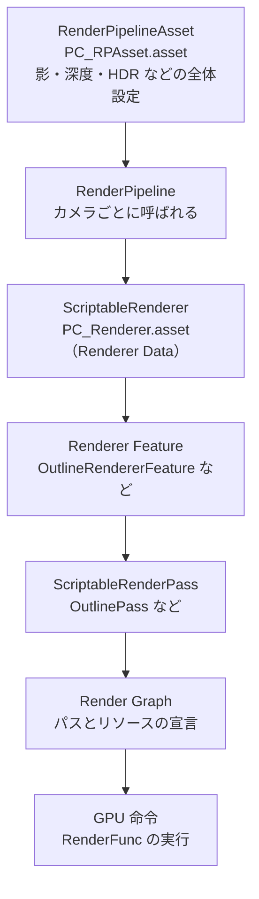
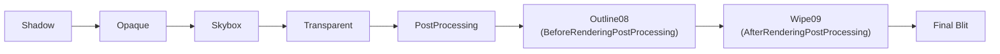
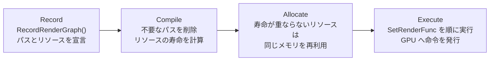
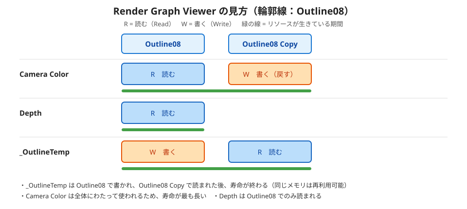
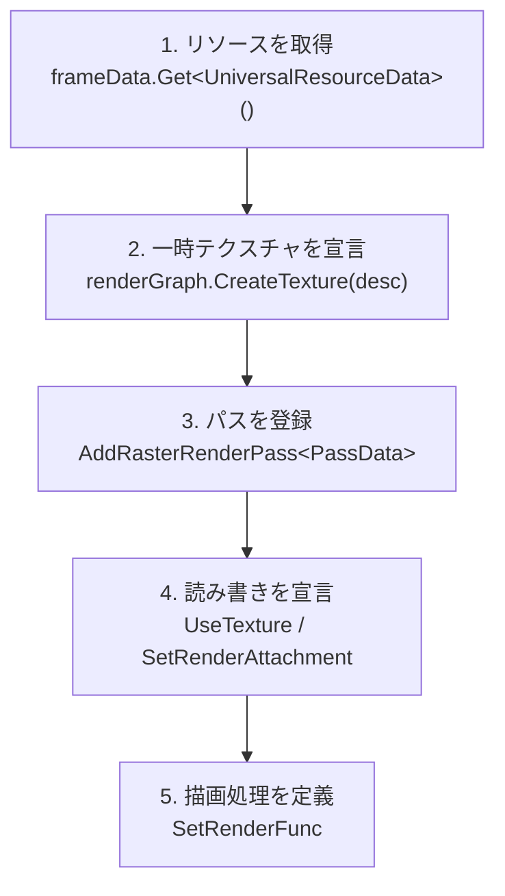
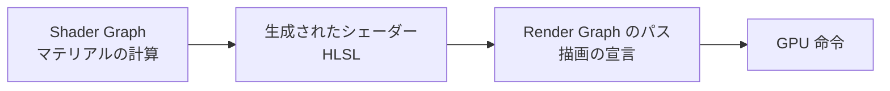
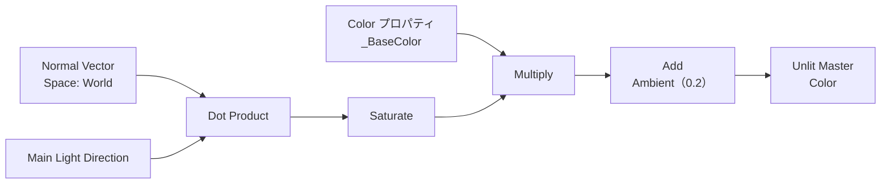
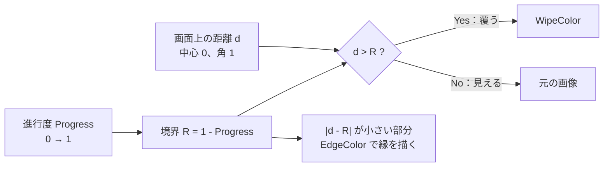

# Chapter 09：Render Graph への移行と Shader Graph・ワイプ演出

この章は、本プロジェクト（Render Graph 有効）で行います。Chapter 08 の輪郭線だけを Render Graph 版へ移行し、その後に Render Graph の構造と Shader Graph の基礎を扱います。最後に、Render Graph を使ったワイプ演出を実装します。

> Chapter 08 のステルス（`Stealth08.shader`）とディザリング透過（`Dither08.shader`）は、マテリアルのシェーダーだけで動作します。`Renderer Feature` や `ScriptableRenderPass` を使わないため、移行は不要です。

---

## 1. 学習目標

- Chapter 08 の輪郭線を、`Execute` 方式から `RecordRenderGraph` 方式へ移行できる
- Render パイプラインの階層と Render Graph の位置づけを説明できる
- Render Graph の Record・Compile・Execute の段階を説明できる
- Render Graph Viewer と Frame Debugger で、パスとリソースの読み書きを読み取れる
- `TextureHandle` とパスの読み書き宣言を使って、フルスクリーン処理を組み立てられる
- Shader Graph でノードを接続し、簡単なライティングを作れる
- Render Graph を使ったワイプ演出を実装し、進行度を C# から制御できる

---

## 2. Chapter 08 輪郭線の Render Graph 版への移行

### 2.1 移行の対象と対象外

| 項目 | 移行の要否 | 理由 |
| :--- | :--- | :--- |
| `OutlinePass.cs` | 移行する | `Execute` を使うため、Render Graph では動かない |
| `OutlineRendererFeature.cs` | 一部変更する | `Dispose` でパスの `RTHandle` を解放していたため、その処理を削除する |
| `OutlineFullscreen08.shader` | 変更しない | `Blit.hlsl` の `_BlitTexture` を使うため、Render Graph でも同じ書き方で動く |
| `EmptyRendererFeature.cs` | 削除する | 教材の骨組みとしての役割を終えたため。残す場合は `RecordRenderGraph` 版の空パスに書き換える |
| `Stealth08.shader` / `StealthController.cs` | 変更しない | マテリアルと `MaterialPropertyBlock` だけで動作するため |
| `Dither08.shader` | 変更しない | 同上 |

### 2.2 Execute と RecordRenderGraph の対応

Chapter 08 の `Execute` では、描画命令を実行時に `CommandBuffer` へ書いていました。Render Graph では、次のように役割が分かれます。

| Chapter 08（Execute） | Chapter 09（Render Graph） | 役割 |
| :--- | :--- | :--- |
| `Execute` の中の `Blitter.BlitCameraTexture` | `AddRasterRenderPass` と `SetRenderFunc` | 処理の宣言と、実際の描画命令を分ける |
| `RTHandle _tempTarget` と `Release` | `renderGraph.CreateTexture` | 一時テクスチャは Render Graph が寿命を管理する |
| `ConfigureInput(Depth)` | `builder.UseTexture(depth)` | 読み取るリソースを、パスごとに宣言する |
| `renderingData.cameraData.renderer.cameraColorTargetHandle` | `UniversalResourceData.activeColorTexture` | カメラのカラーを `TextureHandle` で取得する |

**ポイント**は、`RecordRenderGraph` の中ではまだ GPU の描画が行われないことです。ここでは「どのリソースを読み、どのリソースに書くか」を宣言するだけです。実際の描画は、後で呼ばれる `SetRenderFunc` のラムダ式の中で行われます。

### 2.3 OutlinePass（Render Graph 版）

`Assets/ShaderProgramming/Chapter08/OutlinePass.cs` を次の内容に置き換えます。

```csharp
using UnityEngine;
using UnityEngine.Rendering;
using UnityEngine.Rendering.RenderGraphModule;
using UnityEngine.Rendering.Universal;

public class OutlinePass : ScriptableRenderPass
{
    Material _material;
    OutlineRendererFeature.Settings _settings;

    class PassData
    {
        public TextureHandle source;
        public Material material;
    }

    public OutlinePass()
    {
        // 深度を使うことを URP に伝える（Depth Texture を生成させるため）
        ConfigureInput(ScriptableRenderPassInput.Depth);
    }

    public void Setup(Material material, OutlineRendererFeature.Settings settings)
    {
        _material = material;
        _settings = settings;
    }

    public override void RecordRenderGraph(RenderGraph renderGraph, ContextContainer frameData)
    {
        if (_material == null) return;

        UniversalResourceData resourceData = frameData.Get<UniversalResourceData>();

        // 設定値はレコード時にマテリアルへ反映する（描画時に読まれる）
        _material.SetColor("_OutlineColor", _settings.outlineColor);
        _material.SetFloat("_Threshold", _settings.threshold);
        _material.SetFloat("_Sharpness", _settings.sharpness);
        _material.SetFloat("_Thickness", _settings.thickness);

        TextureHandle source = resourceData.activeColorTexture;
        TextureHandle depth = resourceData.cameraDepthTexture;

        // カメラと同じ形式の一時テクスチャを宣言する（深度は不要）
        TextureDesc desc = renderGraph.GetTextureDesc(source);
        desc.name = "_OutlineTemp";
        desc.clearBuffer = false;
        desc.depthBufferBits = DepthBits.None;
        TextureHandle temp = renderGraph.CreateTexture(desc);

        // パス 1：カラーと深度を読み、輪郭を重ねて temp へ書く
        using (var builder = renderGraph.AddRasterRenderPass<PassData>("Outline08", out var passData))
        {
            passData.source = source;
            passData.material = _material;

            builder.UseTexture(source);
            builder.UseTexture(depth);
            builder.SetRenderAttachment(temp, 0);

            builder.SetRenderFunc((PassData data, RasterGraphContext ctx) =>
            {
                Blitter.BlitTexture(ctx.cmd, data.source, new Vector4(1, 1, 0, 0), data.material, 0);
            });
        }

        // パス 2：temp の結果を、カメラのカラーへ戻す
        RenderGraphBlitUtil.AddCopyPass(renderGraph, temp, source, "Outline08 Copy");
    }
}
```

**コードの要点**

- `desc.name` で、Render Graph Viewer に表示される名前を決めます。
- `builder.UseTexture` で読み取るリソースを宣言すると、Render Graph は依存関係を把握できます。宣言がないパスは、依存関係が正しく扱われません。
- `SetRenderFunc` の中では、`_settings` のようなフィールドを参照しないでください。実行時に値が変わっている可能性があるため、必要な値はレコード時にマテリアルへ反映しておきます。

> **注意（API の版による差）**
> 本節の API 名は、URP 17.x（Unity 6.x）で一般的に使われる書き方です。`TextureHandle` を `Blitter` に渡す部分、`_CameraDepthTexture` を参照させる登録方法（`UseTexture` と `UseGlobalTexture` のどちらか）は、URP のバージョンで書き方が変わることがあります。Package Manager の **Universal RP → Samples** に含まれる Render Graph の Fullscreen サンプルと照合してください。

### 2.4 共通のコピーパス（RenderGraphBlitUtil.cs）

2 つの Blit パスを 1 か所にまとめるため、`Assets/ShaderProgramming/Chapter08/RenderGraphBlitUtil.cs` を作成します。

```csharp
using UnityEngine;
using UnityEngine.Rendering;
using UnityEngine.Rendering.RenderGraphModule;

public static class RenderGraphBlitUtil
{
    class PassData
    {
        public TextureHandle source;
        public Material material;
    }

    // src を dst へ転送する。material が null なら単純コピー
    public static void AddCopyPass(RenderGraph renderGraph, TextureHandle src, TextureHandle dst,
                                   string passName, Material material = null)
    {
        using (var builder = renderGraph.AddRasterRenderPass<PassData>(passName, out var passData))
        {
            passData.source = src;
            passData.material = material;

            builder.UseTexture(src);
            builder.SetRenderAttachment(dst, 0);

            builder.SetRenderFunc((PassData data, RasterGraphContext ctx) =>
            {
                if (data.material != null)
                    Blitter.BlitTexture(ctx.cmd, data.source, new Vector4(1, 1, 0, 0), data.material, 0);
                else
                    Blitter.BlitTexture(ctx.cmd, data.source, new Vector4(1, 1, 0, 0), 0f, false);
            });
        }
    }
}
```

### 2.5 OutlineRendererFeature の変更点

`OutlineRendererFeature.cs` は、次の 2 点だけ変更します。

1. `Create` の中の `_pass = new OutlinePass { ... }` は変更しません。
2. `Dispose` の中の `_pass?.Dispose();` を削除します（Render Graph 版では一時テクスチャを手動で解放しないため）。

```csharp
protected override void Dispose(bool disposing)
{
    CoreUtils.Destroy(_material);
}
```

`AddRenderPasses` の処理（Game カメラのみ、`EnqueuePass`）は、そのまま動作します。

### 2.6 Renderer Data への登録と確認

1. `Assets/Settings/PC_Renderer.asset` を選択する
2. **Add Renderer Feature** から **OutlineRendererFeature** を追加する
3. **Shader** に `OutlineFullscreen08` を割り当てる
4. **Render Pass Event** を `Before Rendering Post Processing` にする
5. Game ビューで輪郭線が出ていることを確認する
6. `Window > Analysis > Render Graph Viewer` を開き、`Outline08` と `Outline08 Copy` が表示されていることを確認する

### 2.7 移行チェックリスト

| 確認項目 | 期待する状態 |
| :--- | :--- |
| Console の警告 | `RecordRenderGraph method` の警告が出ていない |
| Render Graph Viewer | `Outline08`、`Outline08 Copy` が表示される |
| 黒い画面になる | `_OutlineTemp` の書き込み先が `source` と同じになっていないか確認する |
| 線が出ない | Depth Texture が有効か（Pipeline Asset の設定）、Renderer Feature が登録されているか確認する |
| エラーが出る | 2.3 の API 名を URP のサンプルと照合する |

---

## 3. Render パイプラインの構造と Render Graph の関係

### 3.1 階層の整理

Render パイプラインは、設定の階層と、描画の実行の階層に分けて考えると理解しやすくなります。



- **Pipeline Asset**：Chapter 07 で扱った影の設定や、Depth Texture の有無を決めます。
- **Renderer Data**：どのパスを、どの順番で実行するかを決めます。Feature はここに登録します。
- **Render Graph**：Renderer が組み立てたパスを、依存関係をもとに整理して実行します。

### 3.2 1 フレームの流れ



Chapter 08 で示した流れに、本章の 2 つの独自パスを加えた構成です。輪郭線は Post Processing の前、ワイプは Post Processing の後に入ります。

### 3.3 Record・Compile・Execute

Render Graph は、1 フレームの処理を 3 段階に分けます。



| 段階 | 行われること | 開発者が意識すること |
| :--- | :--- | :--- |
| Record | パスの登録、リソースの作成と読み書きの宣言 | 読み書きを正しく `UseTexture` / `SetRenderAttachment` で宣言する |
| Compile | 誰も読まないパスの削除、寿命の計算 | 結果を使わないパスは自動で消えるため、Viewer で確認する |
| Allocate | 一時テクスチャの確保と再利用 | 手動で `Release` する必要がない |
| Execute | 実際の描画 | `SetRenderFunc` の中では、Record 時の値だけを使う |

Execute 方式では、この 3 段階が 1 つにまとまっていました。Render Graph はこれを分けたことで、リソースの再利用と不要パスの削除を自動で行えるようになっています。

### 3.4 Render Graph の 3 要素

| 要素 | 内容 | 本章での例 |
| :--- | :--- | :--- |
| **パス（Pass）** | 1 回の描画・処理の単位 | `Outline08`、`Wipe09` |
| **リソース（Resource）** | パス間で受け渡すテクスチャなど | `activeColorTexture`、`_OutlineTemp` |
| **依存（Dependency）** | どのパスがどのリソースを読み、書くか | 読み書きの宣言（`UseTexture`、`SetRenderAttachment`） |

依存関係が宣言されると、Render Graph は「このパスの結果は次のパスで使われる」ことを理解します。逆に、宣言が不足していると、正しい順序で実行されず、描画結果が壊れます。

### 3.5 UniversalResourceData と ContextContainer

`RecordRenderGraph` の引数 `frameData`（`ContextContainer`）には、URP がフレームごとの情報を格納しています。よく使うのは次のとおりです。

| 取得するもの | 中身 | 用途 |
| :--- | :--- | :--- |
| `UniversalResourceData` | カラー・深度・シャドウなどの `TextureHandle` | 入力と出力のリソースを取得する |
| `UniversalCameraData` | カメラの種類、解像度など | 描画対象のカメラを判定する |
| `UniversalLightData` | ライトの情報 | ライトを使うパスで参照する |

```csharp
UniversalResourceData resourceData = frameData.Get<UniversalResourceData>();
UniversalCameraData cameraData = frameData.Get<UniversalCameraData>();
```

`activeColorTexture` は現在のカメラの描画先で、Post Processing の段階によって指す先が変わることがあります。値を取得する位置を、パスの順番と合わせて確認してください。

### 3.6 Execute 方式と Render Graph 方式の比較

| 項目 | Execute（Compatibility Mode） | Render Graph |
| :--- | :--- | :--- |
| 処理の書き方 | 実行時に `CommandBuffer` へ命令を書く | 宣言（Record）と実行（RenderFunc）を分ける |
| 一時テクスチャ | `RTHandle` を手動で確保・解放する | `CreateTexture` で宣言し、寿命は自動管理 |
| 依存関係 | 開発者が順序を管理する | 読み書きの宣言から自動で把握する |
| 不要パス | 残る | 結果が使われなければ削除される |
| 方式の状態 | 廃止予定 | 現在の標準 |

---

## 4. Render Graph の見方

### 4.1 Render Graph Viewer

`Window > Analysis > Render Graph Viewer` で開きます。Frame Debugger を開いた状態で Game ビューを再生すると、そのフレームの Render Graph が表示されます。

**確認する項目**

| 項目 | 見るポイント |
| :--- | :--- |
| パス一覧 | 実行順。`Outline08` が Post Processing の前後のどこにあるか |
| 読み取り・書き込み | 各パスが、どのリソースを読み、どのリソースに書いたか |
| リソースの寿命 | 一時テクスチャがいつ作られ、いつ使われなくなるか |
| 削除されたパス | 結果が使われず、実行されなかったパス |

### 4.2 Render Graph の見え方（概念図）

次の SVG は、Render Graph Viewer の見え方を簡略化した概念図です。上の行に実行順のパス、左の列にリソースを並べ、各セルで読み書きを示しています。



**読み取りのポイント**

1. `Outline08` は、`Camera Color` と `Depth` を読み（R）、`_OutlineTemp` に書き（W）ます。
2. `Outline08 Copy` は、`_OutlineTemp` を読み、`Camera Color` に書き戻します。
3. `_OutlineTemp` の寿命は、書き込みから読み取りまでの間だけです。その後は、同じメモリを別のリソースに再利用できます。
4. `Camera Color` は全体にわたって使われるため、寿命が最も長くなります。

### 4.3 Frame Debugger での確認

Frame Debugger でも Render Graph のパスを確認できます。Render Graph 版では、パスの名前は `AddRasterRenderPass` に指定した文字列で表示されます。Execute 方式のときに見えていた `ScriptableRenderer.Execute` の項目は、Render Graph を使うと表示が変わります。

---

## 5. Render Graph の利用方法

### 5.1 パスの種類

| パスの種類 | 登録する API | 用途 |
| :--- | :--- | :--- |
| **Raster** | `AddRasterRenderPass<T>` | 描画（ラスタライズ）を行う。フルスクリーン処理、MRT（複数出力）に使う |
| **Unsafe** | `AddUnsafePass<T>` | `CommandBuffer` を直接扱う。柔軟だが、依存関係の検査が弱い |
| **Compute** | `AddComputePass<T>` | Compute シェーダーを実行する（Chapter 13 で扱う） |

本章では Raster パスを使います。フルスクリーン処理では、ほとんどの場合これで足ります。

### 5.2 基本の手順

Render Graph を使うパスは、次の 5 段階で書きます。



### 5.3 テンプレート

```csharp
public override void RecordRenderGraph(RenderGraph renderGraph, ContextContainer frameData)
{
    // 1. リソースを取得
    UniversalResourceData resourceData = frameData.Get<UniversalResourceData>();
    TextureHandle source = resourceData.activeColorTexture;

    // 2. 一時テクスチャを宣言（寿命は Render Graph が管理）
    TextureDesc desc = renderGraph.GetTextureDesc(source);
    desc.name = "_MyTemp";
    desc.clearBuffer = false;
    desc.depthBufferBits = DepthBits.None;
    TextureHandle temp = renderGraph.CreateTexture(desc);

    // 3〜5. パスを登録し、読み書きを宣言し、描画処理を定義する
    using (var builder = renderGraph.AddRasterRenderPass<PassData>("MyPass", out var passData))
    {
        passData.source = source;

        builder.UseTexture(source);          // 読む
        builder.SetRenderAttachment(temp, 0); // 書く

        builder.SetRenderFunc((PassData data, RasterGraphContext ctx) =>
        {
            // ここで GPU 命令を発行する
            Blitter.BlitTexture(ctx.cmd, data.source, new Vector4(1, 1, 0, 0), 0f, false);
        });
    }
}
```

### 5.4 よくある誤り

| 誤り | 症状 | 対処 |
| :--- | :--- | :--- |
| 読むリソースを `UseTexture` で宣言していない | 描画結果が前のフレームのものになる、または黒くなる | 読む前に必ず宣言する |
| 同じリソースを読み書きに同時に使う | エラーまたは不定の結果 | 一時テクスチャを経由して 2 段階に分ける |
| `SetRenderFunc` の中で `this` のフィールドを読む | 実行時の値が反映されない | 必要な値は PassData に入れるか、Record 時にマテリアルへ反映する |
| 一時テクスチャを `Release` しようとする | コンパイルエラーまたは未定義の動作 | Render Graph が管理するため、解放処理を書かない |
| 深度を使うのに Depth Texture を有効にしていない | `_CameraDepthTexture` が黒または無効 | Pipeline Asset の Depth Texture を有効にする |

### 5.5 MRT（複数の出力先）

同じパスで複数のテクスチャに書くこともできます。G-Buffer（Chapter 11）では、この方法で法線・アルベドなどを同時に書きます。

```csharp
builder.SetRenderAttachment(gBuffer0, 0);
builder.SetRenderAttachment(gBuffer1, 1);
builder.SetRenderAttachment(gBuffer2, 2);
```

---

## 6. Shader Graph の基本

### 6.1 Shader Graph とは

Shader Graph は、ノードを線で接続してシェーダーを作るツールです。接続の結果から、HLSL のシェーダーを自動で生成します。

| 比較項目 | ShaderLab + HLSL（Chapter 01〜08） | Shader Graph（Chapter 09） |
| :--- | :--- | :--- |
| 書き方 | テキストで書く | ノードを接続する |
| 出力 | 自分で書いたシェーダー | 生成されたシェーダー（`Open Generated Shader` で確認できる） |
| 細かな制御 | 完全に制御できる | ノードで表現できる範囲に限られる |
| 学習の目的 | 仕組みの理解 | 見た目の試行錯誤、ノード化された計算の理解 |

**本教材の方針**：Shader Graph は、HLSL で学んだ計算がノードでどう表されるかを対応させながら使います。生成されたコードを必ず確認してください。

### 6.2 作成と画面の見方

**作成手順**

1. `Assets/ShaderProgramming/Chapter09/` を右クリックし、`Create > Shader Graph > URP > Unlit Shader Graph` を選ぶ
2. 名前を `Lambert09` にする
3. ダブルクリックしてグラフを開く

**画面の構成**

| 領域 | 内容 |
| :--- | :--- |
| Graph エリア（中央） | ノードを配置して線で接続する |
| Blackboard（左） | Properties（プロパティ）を追加・管理する |
| Graph Inspector（右） | ノードの設定、Precision、Surface などの設定 |
| Master Stack（右端） | 最終出力（Unlit なら Color、Lit なら Base Color など） |
| Main Preview | 結果のプレビュー |

### 6.3 ノードの基本

| 種類 | 代表例 | 役割（HLSL との対応） |
| :--- | :--- | :--- |
| 入力 | Position、Normal Vector、Main Light Direction | `IN.positionWS`、`IN.normalWS`、`GetMainLight().direction` |
| 数学 | Add、Multiply、Dot Product、Saturate | `+`、`*`、`dot()`、`saturate()` |
| 変換 | Transform、Normalize | 座標空間の変換、`normalize()` |
| テクスチャ | Sample Texture 2D | `SAMPLE_TEXTURE2D()` |
| プロパティ | Color、Float、Texture2D | `Properties` ブロックと CBUFFER の変数 |

### 6.4 プロパティ（Exposed）

Blackboard で `+` を押してプロパティを追加します。**Exposed** にチェックを入れると、マテリアルの Inspector に表示されます。

| 設定 | 意味 | HLSL との対応 |
| :--- | :--- | :--- |
| Reference | シェーダー内で使う名前（`_BaseColor`） | ShaderLab の `Properties` の名前 |
| Exposed | Inspector に表示するか | 表示しない場合でも値は保持される |
| Default | 初期値 | `= (1,1,1,1)` などの既定値 |

### 6.5 Vertex と Fragment、Master Stack

Shader Graph は、頂点処理（Vertex）とピクセル処理（Fragment）を分けて扱います。通常は、Fragment 側でノードを接続し、結果を Master Stack に渡します。

| Master Stack の項目 | 対応する HLSL の処理 |
| :--- | :--- |
| Vertex（Position、Normal） | `vert` 関数で出力する位置・法線 |
| Fragment（Color、Alpha、Clip Threshold） | `frag` 関数の戻り値、`clip` |

### 6.6 SubGraph と Custom Function

- **SubGraph**：ノードをまとめて再利用する部品です。複数のグラフで同じ計算を使うときに作ります。
- **Custom Function**：HLSL の関数をノードとして呼び出します。Shader Graph で表現しにくい処理（分岐や独自の計算）に使います。

```hlsl
// Custom Function（File モード）の例：Lambert.hlsl
void Lambert_float(float3 Normal, float3 Albedo, out float3 Out)
{
    Light mainLight = GetMainLight();
    float NdotL = saturate(dot(normalize(Normal), normalize(mainLight.direction)));
    Out = Albedo * mainLight.color * NdotL;
}
```

> Custom Function の関数名には、精度のサフィックス（`_float`、`_half`）が必要です。引数名と型が、グラフ側のノードの入出力と一致しているか確認してください。

---

## 7. Shader Graph と Render パイプライン・Render Graph の関係

Shader Graph と Render Graph は、扱う対象が異なります。

| 項目 | Shader Graph | Render Graph |
| :--- | :--- | :--- |
| 対象 | 1 つのマテリアルの見た目（頂点・ピクセルの計算） | 1 フレームの描画パスの組み立て |
| 単位 | マテリアル（Pass の中） | パス（フルスクリーン処理・描画処理） |
| 出力 | シェーダーファイル（HLSL） | 描画命令の順序と、リソースの管理 |
| 関係 | Shader Graph で作ったシェーダーは、Render Graph の中のパスで使われる | Render Graph のパスの中で、Shader Graph のマテリアルを描画することもできる |

**フルスクリーン処理を Shader Graph で作る方法**

URP 17 では、Renderer Feature の **Full Screen Pass Renderer Feature** を使うと、Fullscreen 用の Shader Graph を直接登録できます。本章では、この方法と、C# で書いたパスの違いを 9.6 で比較します。



---

## 8. 簡単なシェーディングの実装例：Lambert

### 8.1 目標

表面の向きとライトの向きの内積（`N·L`）で明るさを決める、Lambert 拡散反射を Shader Graph で作ります。第 2 章で HLSL で書いた `saturate(dot(N, L))` と同じ計算です。

### 8.2 ノード構成



### 8.3 手順

1. `Lambert09` を開く（Unlit Shader Graph）
2. Blackboard で Color プロパティ `_BaseColor` を追加し、Exposed にする
3. **Normal Vector** ノードを追加し、Space を `World` にする
4. **Main Light Direction** ノードを追加する（Create Node 検索で `Main Light Direction` と入力する。見つからない場合は Custom Function で `GetMainLight().direction` を返す）
5. **Dot Product** ノードを追加し、Normal Vector と Main Light Direction を接続する
6. **Saturate** ノードを追加し、Dot Product の出力を接続する（負の値を 0 に丸める）
7. **Multiply** ノードを追加し、`_BaseColor` と Saturate の出力を接続する
8. **Add** ノードを追加し、Multiply の出力と、Color `(0.2, 0.2, 0.2)` を接続する（環境光の代わり）
9. Add の出力を Master Stack の **Color** に接続する
10. Main Preview で、ライトの向きを変えて明暗が変わることを確認する

### 8.4 生成コードとの対応

| ノード | HLSL の対応 |
| :--- | :--- |
| Normal Vector（World） | `normalize(IN.normalWS)` |
| Main Light Direction | `GetMainLight().direction` |
| Dot Product | `dot(N, L)` |
| Saturate | `saturate(...)` |
| Multiply | `_BaseColor.rgb * NdotL` |
| Add | `+ ambient` |

**確認方法**：グラフの上部の **View Generated Shader**（または Graph Inspector の Generated Code）を開き、`saturate(dot(...))` の行を探してください。ノードの接続が、そのまま式になっていることが分かります。

### 8.5 確認ポイント

- ライトを真上から当てると、上を向いた面が明るくなる
- ライトの裏側に回ると、その面は環境光の分だけになる（負の値が 0 に丸められている）
- `_BaseColor` を変えると、明るい部分の色だけが変わる

---

## 9. ワイプ演出の実装（Render Graph）

### 9.1 演出の設計

ワイプは、画面の一部を別の色で覆うことで場面転換を表す演出です。本章では次の 2 種類を実装します。

| モード | 形状 | 進行度 0 | 進行度 1 |
| :--- | :--- | :--- | :--- |
| **Iris（アイリス）** | 中心から円が閉じる | 画面全体が見える | 画面全体が覆われる |
| **Horizontal（水平）** | 左から右へ覆う | 画面全体が見える | 画面全体が覆われる |

**進行度 `_Progress`** を 0 から 1 へ動かすと、覆われる範囲が広がります。覆う境界には、輝く縁（エッジ）を付けます。



**進行度と境界の関係**：`R = 1 - Progress` とすると、Progress が 0 のとき `R = 1` で、覆われる領域がありません。Progress が 1 のとき `R = 0` で、画面全体が覆われます。

### 9.2 シェーダー（WipeFullscreen09.shader）

`Assets/ShaderProgramming/Chapter09/WipeFullscreen09.shader` を作成します。

```shaderlab
Shader "ShaderProgramming/Chapter9/WipeFullscreen09"
{
	Properties
	{
		_WipeColor ("Wipe Color", Color) = (0,0,0,1)
		_EdgeColor ("Edge Color", Color) = (1,0.6,0.1,1)
		_Progress ("Progress", Range(0,1)) = 0
		_EdgeWidth ("Edge Width", Range(0,0.1)) = 0.02
		_Softness ("Softness", Range(0.001,0.3)) = 0.03
		_Mode ("Mode (0=Iris,1=Horizontal)", Float) = 0
	}

	SubShader
	{
		Tags { "RenderPipeline"="UniversalPipeline" }

		Cull Off
		ZWrite Off
		ZTest Always

		Pass
		{
			Name "WipeFullscreen"

			HLSLPROGRAM
			#pragma vertex Vert
			#pragma fragment Frag

			#include "Packages/com.unity.render-pipelines.universal/ShaderLibrary/Core.hlsl"
			#include "Packages/com.unity.render-pipelines.core/Runtime/Utilities/Blit.hlsl"

			half4 _WipeColor;
			half4 _EdgeColor;
			float _Progress;
			float _EdgeWidth;
			float _Softness;
			float _Mode;

			half4 Frag(Varyings input) : SV_Target
			{
				float2 uv = input.texcoord;

				// 距離 d を 0〜1 に正規化する
				float d;
				if (_Mode < 0.5)
				{
					// Iris：画面の縦横比を補正した中心からの距離（角で 1）
					float aspect = _ScreenParams.x / _ScreenParams.y;
					float2 p = (uv - 0.5) * float2(aspect, 1.0);
					float halfDiag = 0.5 * length(float2(aspect, 1.0));
					d = length(p) / halfDiag;
				}
				else
				{
					// Horizontal：左から右へ 0〜1
					d = uv.x;
				}

				// 境界 R：Progress 0 で 1（覆わない）、Progress 1 で 0（全部覆う）
				float R = 1.0 - _Progress;

				// 覆う領域（滑らかな境界）
				float mask = smoothstep(R - _Softness, R + _Softness, d);

				// 縁の線：境界付近だけを強める（進行中のみ）
				float active = step(0.001, _Progress) * step(_Progress, 0.999);
				float edge = (1.0 - smoothstep(0.0, _EdgeWidth, abs(d - R))) * active;

				// 元の画像（_BlitTexture は直前までの描画結果）
				half3 scene = SAMPLE_TEXTURE2D_X(_BlitTexture, sampler_LinearClamp, uv).rgb;

				half3 col = lerp(scene, _WipeColor.rgb, mask);
				col = lerp(col, _EdgeColor.rgb, edge);
				return half4(col, 1.0h);
			}
			ENDHLSL
		}
	}
}
```

**コードの要点**

- `smoothstep(R - _Softness, R + _Softness, d)` は、境界で 0 から 1 へ滑らかに変化する値を作ります。境界がぎざぎざにならないようにするためです。
- `active` は、Progress が 0 または 1 のとき縁を消すための係数です。完全に開いた状態や覆われた状態で、縁の線が残らないようにしています。
- `Blit.hlsl` の `_BlitTexture` は、Outline と同じく直前までのカラーです。

### 9.3 Renderer Feature と Render Pass（WipeRendererFeature.cs）

`Assets/ShaderProgramming/Chapter09/WipeRendererFeature.cs` を作成します。Feature とパスは同じファイルに入れています。

```csharp
using UnityEngine;
using UnityEngine.Rendering;
using UnityEngine.Rendering.RenderGraphModule;
using UnityEngine.Rendering.Universal;

public class WipeRendererFeature : ScriptableRendererFeature
{
    public enum WipeMode { Iris = 0, Horizontal = 1 }

    [System.Serializable]
    public class Settings
    {
        public RenderPassEvent renderPassEvent = RenderPassEvent.AfterRenderingPostProcessing;
        public Shader shader;
        public WipeMode mode = WipeMode.Iris;
        public Color wipeColor = Color.black;
        public Color edgeColor = new Color(1f, 0.6f, 0.1f, 1f);
        [Range(0f, 0.1f)] public float edgeWidth = 0.02f;
        [Range(0.001f, 0.3f)] public float softness = 0.03f;
    }

    // 進行度（0 = 全部見える、1 = 全部覆われる）。WipeController から設定する
    public static float Progress;

    public Settings settings = new Settings();

    WipePass _pass;
    Material _material;

    public override void Create()
    {
        CoreUtils.Destroy(_material);
        _material = settings.shader != null ? CoreUtils.CreateEngineMaterial(settings.shader) : null;

        _pass = new WipePass
        {
            renderPassEvent = settings.renderPassEvent
        };
    }

    public override void AddRenderPasses(ScriptableRenderer renderer, ref RenderingData renderingData)
    {
        if (_material == null) return;
        if (renderingData.cameraData.cameraType != CameraType.Game) return;

        _pass.Setup(_material, settings);
        renderer.EnqueuePass(_pass);
    }

    protected override void Dispose(bool disposing)
    {
        CoreUtils.Destroy(_material);
    }
}

public class WipePass : ScriptableRenderPass
{
    Material _material;
    WipeRendererFeature.Settings _settings;

    public void Setup(Material material, WipeRendererFeature.Settings settings)
    {
        _material = material;
        _settings = settings;
    }

    public override void RecordRenderGraph(RenderGraph renderGraph, ContextContainer frameData)
    {
        if (_material == null) return;

        UniversalResourceData resourceData = frameData.Get<UniversalResourceData>();

        // 値はレコード時にマテリアルへ反映する
        _material.SetFloat("_Progress", WipeRendererFeature.Progress);
        _material.SetColor("_WipeColor", _settings.wipeColor);
        _material.SetColor("_EdgeColor", _settings.edgeColor);
        _material.SetFloat("_EdgeWidth", _settings.edgeWidth);
        _material.SetFloat("_Softness", _settings.softness);
        _material.SetFloat("_Mode", (float)_settings.mode);

        TextureHandle source = resourceData.activeColorTexture;

        TextureDesc desc = renderGraph.GetTextureDesc(source);
        desc.name = "_WipeTemp";
        desc.clearBuffer = false;
        desc.depthBufferBits = DepthBits.None;
        TextureHandle temp = renderGraph.CreateTexture(desc);

        // パス 1：ワイプを重ねて temp へ書く
        RenderGraphBlitUtil.AddCopyPass(renderGraph, source, temp, "Wipe09", _material);

        // パス 2：temp の結果をカメラのカラーへ戻す
        RenderGraphBlitUtil.AddCopyPass(renderGraph, temp, source, "Wipe09 Copy");
    }
}
```

**設計のポイント**

- `Progress` を `static` にしているのは、教材として C# からの値の受け渡しを単純にするためです。複数のカメラや複数のワイプを同時に扱う場合は、`Settings` 側に持たせる設計に変えてください。
- `RecordRenderGraph` の中で値をマテリアルに反映するため、同じフレームのワイプは、そのフレームの進行度で描かれます。
- `AddCopyPass` の第 3 引数に `Material` を渡すと、ワイプの描画になります。第 3 引数を省略すると、単純なコピーになります。

### 9.4 進行度を制御する（WipeController.cs）

`Assets/ShaderProgramming/Chapter09/WipeController.cs` を作成します。Space キーを押すたびに、覆う・戻すを切り替えます。

```csharp
using UnityEngine;
using UnityEngine.InputSystem;

public class WipeController : MonoBehaviour
{
    [Tooltip("進行度が変化する速さ（1 秒あたり）")]
    public float speed = 1.5f;

    [Tooltip("true なら覆う方向、false なら戻す方向へ動く")]
    public bool covering = true;

    void Update()
    {
        var keyboard = Keyboard.current;
        if (keyboard != null && keyboard.spaceKey.wasPressedThisFrame)
        {
            covering = !covering;
        }

        float target = covering ? 1f : 0f;
        WipeRendererFeature.Progress = Mathf.MoveTowards(
            WipeRendererFeature.Progress, target, speed * Time.deltaTime);
    }
}
```

**使い方**

- 空の GameObject（例：`WipeManager`）を作成し、このスクリプトを追加する
- Play を押し、Space を押すと覆われ、もう一度押すと戻る
- 進行度は Feature が参照するため、Inspector の値は変わりません

> `Keyboard.current` は Input System パッケージを使います。本プロジェクトは Input System の設定ファイル（`InputSystem_Actions.inputactions`）を持つため、そのまま使えます。

### 9.5 Renderer Data への登録と確認

1. `Assets/Settings/PC_Renderer.asset` を選択する
2. **Add Renderer Feature** から **WipeRendererFeature** を追加する
3. **Shader** に `WipeFullscreen09` を割り当てる
4. **Mode** を `Iris` にする
5. Wipe Color を黒、Edge Color をオレンジに設定する
6. Play し、Space キーでワイプが覆う・戻ることを確認する
7. Render Graph Viewer で `Wipe09` と `Wipe09 Copy` が、`Outline08` の後に表示されていることを確認する

**確認ポイント**

| 確認項目 | 期待する状態 |
| :--- | :--- |
| 進行度 0 | 画面が通常どおり見える |
| 進行度 1 | 画面全体が Wipe Color で覆われる |
| 途中の状態 | 縁がオレンジの線で見える |
| Mode を Horizontal にする | 左から右へ覆われる |
| 輪郭線と併用 | 輪郭線の上にワイプが重なる（順序の確認） |

### 9.6 Shader Graph 版との比較（Full Screen Pass）

同じ演出は、Full Screen Pass Renderer Feature と Fullscreen 用の Shader Graph でも作れます。

| 項目 | C# の Render Pass（本章） | Full Screen Pass + Shader Graph |
| :--- | :--- | :--- |
| 作成の手間 | C# とシェーダーの両方を書く | シェーダーをグラフで作る |
| 制御 | 細かく制御できる（複数パス、MRT、別テクスチャ） | 1 枚のフルスクリーン処理に限られる |
| 進行度の受け渡し | `static` 変数やマテリアルのプロパティ | グラフの Exposed プロパティ |
| 学習の目的 | Render Graph の仕組みの理解 | 見た目の試行錯誤 |

**本章の方針**：ワイプは、Render Graph のパス構造を理解するための題材として C# で実装しました。Shader Graph で同じ見た目を作る課題は、発展として扱ってください。

---

## 10. 実習手順

1. Chapter 08 の `OutlinePass.cs` を Render Graph 版に置き換え、`RenderGraphBlitUtil.cs` を追加する
2. `OutlineRendererFeature.cs` の `Dispose` を修正し、`PC_Renderer.asset` で輪郭線が出ることを確認する
3. Render Graph Viewer で、`Outline08` と `Outline08 Copy` の読み書きを確認し、スクリーンショットに描き写す
4. `Lambert09` の Shader Graph を作成し、`_BaseColor` とライトの向きで明暗が変わることを確認する
5. View Generated Shader で、`saturate(dot(...))` の行を探し、ノードとの対応を確認する
6. `WipeFullscreen09.shader`、`WipeRendererFeature.cs`、`WipeController.cs` を作成し、`PC_Renderer.asset` に登録する
7. Space キーでワイプを動かし、Iris と Horizontal の違いを観察する
8. Render Graph Viewer で、`Wipe09` が `Outline08` の後に実行されていることを確認する
9. 発展課題：`Wipe Color` に画像を使えるように、Texture2D のプロパティを追加し、覆った部分に画像を表示させる

---

## 11. トラブルシューティング

| 症状 | 原因と対処 |
| :--- | :--- |
| `RecordRenderGraph` の警告が出る | Execute 方式のパスが残っている。`EmptyRendererFeature` を登録から外す |
| 輪郭線やワイプが黒くなる | 読み取りの宣言（`UseTexture`）が不足している、または `source` と `temp` の順序が逆 |
| 深度を使うと線が出ない | Depth Texture が無効、または `_CameraDepthTexture` の登録方法がバージョンに合っていない（2.3 の注意を参照） |
| ワイプが覆わない | `Progress` が 0 のまま。`WipeController` が動いているか、Console のエラーを確認する |
| 縁が画面全体に出る | `_EdgeWidth` が大きすぎる、または `active` が効いていない（Progress の値を確認） |
| Iris が楕円に見える | `_ScreenParams` の縦横比補正が効いていない。Game ビューの解像度を確認する |
| Space キーに反応しない | Input System が有効か（Project Settings の Active Input Handling）、Game ビューにフォーカスがあるか確認する |
| Shader Graph のノードが見つからない | URP のバージョンによりノード名が異なる。Custom Function で代用する |

---

## 12. まとめ

- 輪郭線は、`Execute` の命令を `RecordRenderGraph` の宣言と `SetRenderFunc` の実行に分けることで、Render Graph 版に移行できる
- Render パイプラインは、Pipeline Asset → Renderer Data → Feature → Pass → Render Graph という階層で組み立てられ、Render Graph は Record・Compile・Execute の 3 段階で実行される
- Render Graph Viewer では、パスの順序と、リソースの読み書き・寿命を読み取れる
- `TextureHandle` と読み書きの宣言によって、依存関係と一時テクスチャの寿命が自動的に管理される
- Shader Graph は、ノードの接続で HLSL の計算を表すツールであり、生成されたコードを確認することで、HLSL で学んだ内容と結びつけられる
- ワイプは、進行度から境界を作り、滑らかな遷移と縁の線を重ねる演出であり、Render Graph のフルスクリーンパスとして実装できる

次の第 10 章では、Volume と Post Processing を扱い、本章で作った Render Graph のパスを、ブルームのような複数段階の画像処理へ応用します。
